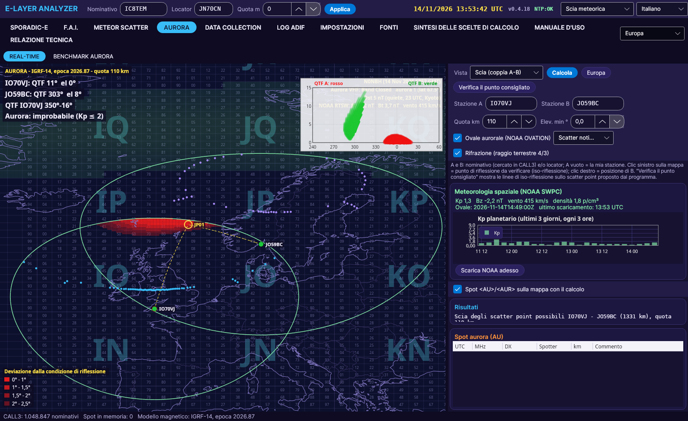
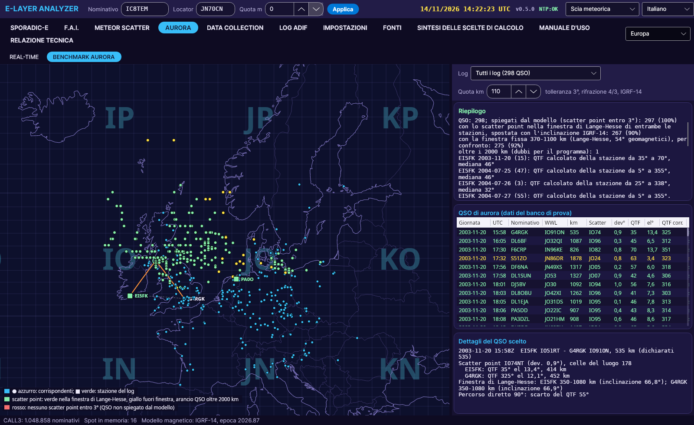

# AURORA

[← Home](Home-et)

- NOAA OVATION Prime **aurora ovaal** (varjutatud), viimase 3 päeva **Kp**, **päikesetuul** (Bz, kiirus, tihedus), uuendatakse iga 5 minuti järel ja salvestatakse kausta `data/swpc`.
- Samad vaated nagu F.A.I.-l: **Scatter trail** jaamapaari jaoks ja **Isopeegeldus** punkti kontrollimiseks, vaikimisi kõrgusega 110 km.
- **Soovitatud antenni suund mõlemale jaamale**: iga jaama ristsuunalisel joonel (selle värvi punktiir) punkt, kus ovaali tõenäosus on suurim. Rusikareegel (G3WPO): alusta umbes 45° juurest, põhja ja ida vahel.
- Näide IO70VJ - JO59BC: hajumispunkt JP01AK Shetlandi saarte lähedal, hälve 0,97°, QTF 11° ja 299°.
- **Aurora spotid kaardil**: spotid, mille tekstis on **<AU>** või **<AUR>**, on aurora spotid (autori reegel). Kui kast *<AU>/<AUR> spotid kaardil koos arvutusega* on märgitud, kuvab sakk viimase 2 tunni spotid (kuni 30): iga spotteri-DX-i paari jaoks arvutatakse Scatter trail ja näidatakse kõige tõenäolisemat hajumispunkti (oranž ring), tulemustes on mõlema jaama QTF ja elevatsioon.
- Lisaks kõige tõenäolisemale hajumispunktile näitavad tulemused mõlema jaama **QTF-i vahemikku** kogu Scatter traili ulatuses (hälve ≤ 1,5°).
- **Lange-Hesse aken**: hajumispunkti eelistatakse 370-1100 km kaugusel kummastki jaamast, aknas, mille Lange-Hesse arvutas 54° geomagnetilisel laiusel. Alates versioonist 0.4.5 nihkub aken iga jaama IGRF-14 inklinatsiooni järgi: lõunapoolsematel jaamadel lähemale, põhjapoolsematel kaugemale (nt Capri umbes 260-990 km, Oslo 470-1200 km). Tulemused näitavad mõlema jaama akent.

## BENCHMARK AURORA

Sakil AURORA on kaks alamsakki: **REAL-TIME** (eespool kirjeldatud arvutus) ja **BENCHMARK AURORA**, mudeli katsestend **298 tegeliku aurora QSO** põhjal kellaaja ja lokaatoriga: EI5FK avaldatud logid (IO51RT, Iirimaa, 2003-2005, 144 ja 432 MHz) ja PA0O logi kaart (JO33HG, Holland).

- Iga QSO jaoks arvutab programm hajumispunkti sama mudeliga (IGRF-14, kõrgus 110 km, murdumine 4/3, tolerants 3°).
- Värvid: **roheline** = hajumispunkt mõlema jaama Lange-Hesse aknas; **kollane** = seletatud, kuid sellest aknast väljas; **oranž** = QSO üle 2000 km; **punane** = hajumispunkti pole, mudel QSO-d ei seleta.
- Kokkuvõte annab protsendid, ka võrdluseks fikseeritud aknaga 370-1100 km, ning iga logi kohta arvutatud QTF-i vahemiku ja mediaani. Klõps real joonistab trassi ja mõlemad antennisuunad.
- Tulemus (versioon 0.4.4): **298-st QSO-st on seletatud 296 (99%)**, 243 (82%) on 370-1100 km aknas; EI5FK QTF-i mediaan on 25° kuni 41°, ehk G3WPO soovitatud kirre. Logid ei märgi antennisuunda: kontrollitakse geomeetriat, mitte QTF-i. Liikuva aknaga (versioon 0.4.5) on tulemus sama, 243 QSO-d (82%), mis fikseeritud aknaga: katsestendi jaamadel (Iirimaa, Suurbritannia, Holland, Saksamaa) on inklinatsioon 66-70°, lähedane Lange-Hesse võrdluspunktile (EI5FK aken 350-1080 km); erinevus puudutab lõunapoolsemaid või põhjapoolsemaid jaamu, mille kohta katsestendil QSO-sid pole.
