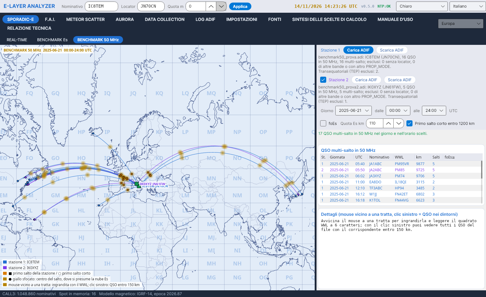
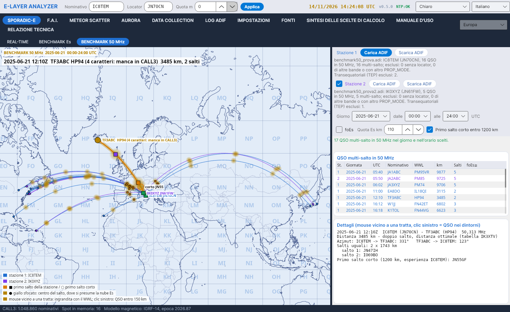
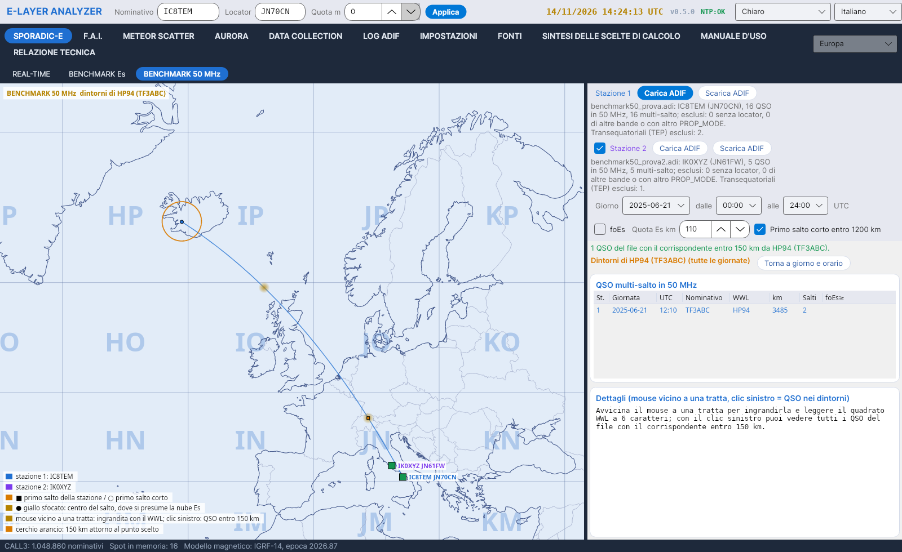

# BENCHMARK 50 MHz

[← Home](Home-de)

Prüfstand für **Sporadic-E im Mehrfachsprung auf 50 MHz** anhand des ADIF-Logs einer Station und, optional, einer zweiten Station.

## Die Logs laden

- **Station 1**: *ADIF laden* / *ADIF entladen*. Das Programm übernimmt `STATION_CALLSIGN` und `MY_GRIDSQUARE` aus dem Log; die Sendeposition ist das `MY_GRIDSQUARE` jedes QSOs.
- **Station 2** (optional): dieselben Schaltflächen in der zweiten Zeile; das Kästchen *Station 2* blendet sie ein oder aus. Die Strecken von Station 1 sind hellblau, die von Station 2 violett.
- Das Programm verwendet 50-MHz-QSOs mit Locator (fehlende oder 4-stellige Locator werden aus CALL3 genommen) im Mehrfachsprung: jenseits von 3100 km (Regel des Autors; die Anzahl der Sprünge folgt der Tabelle IK3XTV).
- **Transäquatoriale** Verbindungen werden ausgeschlossen (Regel des Autors): Richtung Afrika und Südamerika, mit dem Mittelpunkt im Band der magnetischen Inklination zwischen -20° und +20°, es sei denn, das Log enthält `PROP_MODE=ES`.

## Tag und Uhrzeit

Wählen Sie den **Tag** (beim Öffnen der mit den meisten Mehrfachsprung-QSOs) und die Uhrzeit **von… bis…** UTC, in Schritten von 15 Minuten. Das Kästchen **foEs** (optional) färbt die Strecken nach minimaler foEs und zeigt sie in der Tabelle.

## Die Karte

**Mercator**-Karte mit frei wählbarer Mitte: Mausrad = Zoom, Ziehen = Verschieben.

- Ein **unscharfer gelber Punkt** markiert die Mitte jedes Sprungs, wo die Es-Wolke vermutet wird; auf der Strecke unter der Maus wird er größer.
- **Maus nahe einer Strecke**: Linie und Symbole werden vergrößert, und das **6-stellige WWL-Feld** der Gegenstation erscheint.
- **Linksklick** auf diese Strecke: Eine Abfrage fragt, ob **alle QSOs der Datei** (alle Tage) angezeigt werden sollen, deren Gegenstelle **innerhalb von 150 km** um diesen Punkt liegt. *Ja*: Die Karte wird geleert und zeigt diese QSOs im orangen Kreis; *Nein*: Die Karte bleibt, wie sie ist. *Zurück zu Tag und Uhrzeit* stellt die vorherige Auswahl wieder her.

## Details

Für die gewählte Strecke: Entfernung und Einstufung nach der Tabelle IK3XTV, Azimut in beiden Richtungen, gleiche Sprünge mit den Feldern der Reflexionspunkte, kurzer erster Sprung bis 1200 km (Erfahrung IC8TEM) und, mit dem Kästchen foEs, die minimale foEs.
