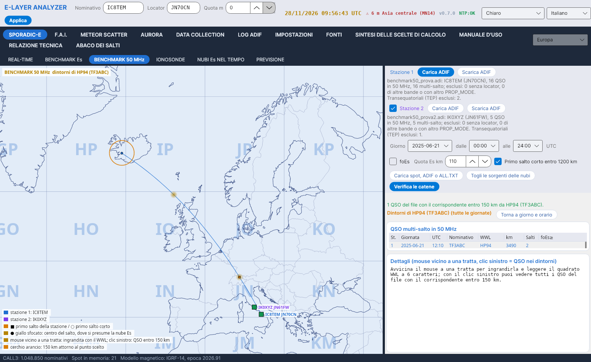

# BENCHMARK 50 MHz

[← Home](Home-ja)

1 局の ADIF ログ (必要なら 2 局目のログも) を使った、**50 MHz のマルチホップ スポラディックE** の検証台です。

## ログの読み込み

- **局 1**: *ADIF を読込* / *ADIF を閉じる*。プログラムはログから `STATION_CALLSIGN` と `MY_GRIDSQUARE` を取得します。送信位置は各 QSO の `MY_GRIDSQUARE` です。
- **局 2** (任意): 2 行目の同じボタン。*局 2* チェックボックスで表示/非表示を切り替えます。局 1 のパスは水色、局 2 のパスは紫です。
- 使用するのはロケーター付きの 50 MHz の QSO (ロケーターがない、または 4 文字の場合は CALL3 から取得) で、マルチホップのもの: 3100 km 超 (作者のルール。ホップ数は IK3XTV の表による) です。
- **赤道横断 (TEP)** の交信は除外します (作者のルール): アフリカと南米方向で、中間点が伏角 -15° から +15° の帯にあるもの。ただしログに `PROP_MODE=ES` がある場合は除きます。

## 日と時刻

**日** (開いたときはマルチホップ QSO が最も多い日) と、UTC の時刻 **から… まで…** を 15 分刻みで選びます。**foEs** チェックボックス (任意) をオンにすると、パスを最小 foEs で色分けし、表にも表示します。

## 地図

中心を自由に動かせる **メルカトル図法** の地図: ホイール = ズーム、ドラッグ = 移動。

- **ぼかした黄色の点** が各ホップの中心、すなわち Es 雲があると推定される地点を示します。マウスの下のパスでは大きくなります。
- **マウスをパスに近づける**: 線とアイコンが拡大し、相手局の **6 文字の WWL グリッド** が表示されます。
- そのパスを **左クリック**: その地点から **150 km 以内** に相手側の位置がある **ファイル内の全 QSO** (全日) を表示するかをポップアップで尋ねます。*はい*: 地図をクリアし、オレンジの円の中にそれらの QSO を表示します。*いいえ*: 地図はそのままです。*日と時刻に戻る* で前の選択に戻ります。

## 詳細

選択したパスについて: 距離と IK3XTV の表による評価、双方向の方位角、反射点のグリッド付きの等ホップ、1200 km 以内の短い第 1 ホップ (IC8TEM の経験)、そして foEs チェックボックスがオンなら最小 foEs。

## チェーンの検証 (バージョン 0.6.0 から)

**スポット、ADIF、ALL.TXT を読込** (Es 雲の時間変化 からエクスポートしたスポット、他局の ADIF ログ、JTDX または WSJT-X の ALL.TXT デコード: コールサインは送信行から識別されます) と **チェーンを検証**: プログラムは局 1 のマルチホップの開けに対して短ホップのチェーンのルールを再現し、何件の開けを事前に示せたか (アラート、前兆、または最初の短ホップのみ)、先行時間の中央値、マルチホップの QSO が続かなかったアラートを書きます。ソースを読み込まないと雲はログからしか求められず、最後の短ホップはほとんど見えません: 遠い局のデータが必要です。

**アラートの検証** (バージョン 0.6.5 から): 15 分ごとに再生したアラートと前兆について、レポートは成功した数 (次の 1 時間に同じ方向のマルチホップ QSO)、誤警報、チェーンのない同じセクターでの比較値を示す。

