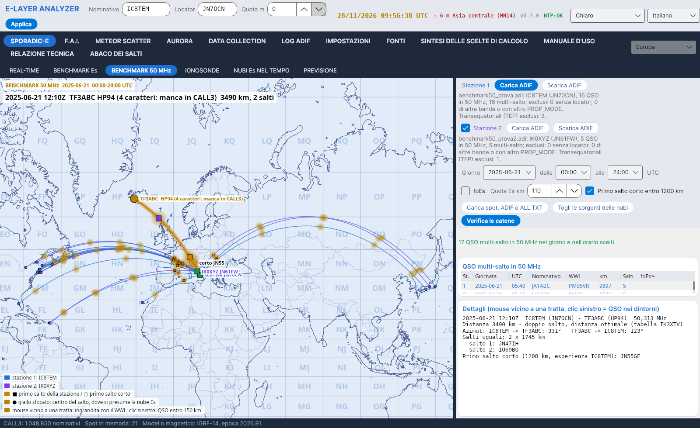

# BENCHMARK 50 MHz

[← Home](Home-lv)

Pārbaudes stends **vairāklēcienu sporādiskajam E 50 MHz** joslā, izmantojot vienas stacijas un, ja vēlas, otras stacijas ADIF žurnālu.

## Žurnālu ielāde

- **Stacija 1**: *Ielādēt ADIF* / *Izņemt ADIF*. Programma no žurnāla ņem `STATION_CALLSIGN` un `MY_GRIDSQUARE`; raidīšanas vieta ir katra QSO `MY_GRIDSQUARE`.
- **Stacija 2** (neobligāti): tās pašas pogas otrajā rindā; izvēles rūtiņa *Stacija 2* to parāda vai paslēpj. Stacijas 1 trases ir gaiši zilas, stacijas 2 – violetas.
- Programma izmanto 50 MHz QSO ar lokatoru (trūkstošie vai 4 rakstzīmju lokatori tiek ņemti no CALL3), vairāklēcienu: virs 3100 km (autora likums; lēcienu skaits atbilst IK3XTV tabulai).
- **Transekvatoriālie** sakari tiek izslēgti (autora likums): virzienā uz Āfriku un Dienvidameriku, ja viduspunkts ir magnētiskās inklinācijas joslā starp -15° un +15°, ja vien žurnālā nav `PROP_MODE=ES`.

## Diena un laiks

Izvēlies **dienu** (atverot – to, kurā visvairāk vairāklēcienu QSO) un laiku **no… līdz…** UTC ar 15 minūšu soli. Izvēles rūtiņa **foEs** (neobligāta) iekrāso trases pēc minimālās foEs un parāda to tabulā.

## Karte

**Merkatora** karte ar brīvu centru: ritenītis = tālummaiņa, vilkšana = pārvietošana.

- **Izplūdis dzeltens punkts** atzīmē katra lēciena centru, kur tiek pieņemts Es mākonis; uz trases zem peles tas kļūst lielāks.
- **Pele pie trases**: līnija un ikonas tiek palielinātas un parādās korespondenta **6 rakstzīmju WWL kvadrāts**.
- **Kreisais klikšķis** uz šīs trases: uznirstošs logs jautā, vai parādīt **visus failā esošos QSO** (visas dienas), kuru tālā gala vieta ir **150 km robežās** no šī punkta. *Jā*: karte tiek notīrīta un rāda šos QSO oranžajā aplī; *Nē*: karte paliek, kāda bija. *Atpakaļ uz dienu un laiku* atgriež iepriekšējo atlasi.

## Detaļas

Izvēlētajai trasei: attālums un vērtējums pēc IK3XTV tabulas, azimuts abos virzienos, vienādi lēcieni ar atstarošanas punktu kvadrātiem, īss pirmais lēciens līdz 1200 km (IC8TEM pieredze) un, ja atzīmēta foEs rūtiņa, minimālā foEs.

## Ķēžu pārbaude (kopš versijas 0.6.0)

**Ielādēt spotus, ADIF vai ALL.TXT** (no Es MĀKOŅI LAIKĀ eksportēti spoti, citu staciju ADIF žurnāli, JTDX vai WSJT-X ALL.TXT dekodējumi: izsaukuma signālu atpazīst pēc raidīšanas rindām) un **Pārbaudīt ķēdes**: programma atkārto īso lēcienu ķēžu noteikumu stacijas 1 vairāklēcienu atvēršanās gadījumiem un norāda, cik atvēršanās tā būtu paredzējusi iepriekš (BRĪDINĀJUMS, PRIEKŠVĒSTNESIS vai tikai pirmais īsais lēciens), laika priekšrocības mediānu un brīdinājumus, kuriem nesekoja vairāklēcienu QSO. Bez ielādētiem avotiem mākoņi nāk tikai no žurnāla, un pēdējais īsais lēciens gandrīz nav redzams: vajag tālu staciju datus.

**Brīdinājumu pārbaude** (no versijas 0.6.5): BRĪDINĀJUMIEM un PRIEKŠVĒSTNEŠIEM, kas atkārtoti ik pēc 15 minūtēm, atskaite norāda, cik no tiem izdevās (vairāklēcienu QSO tajā pašā virzienā nākamajās 2 stundās), viltus trauksmes un salīdzinājuma vērtību tajos pašos sektoros bez ķēdēm.

