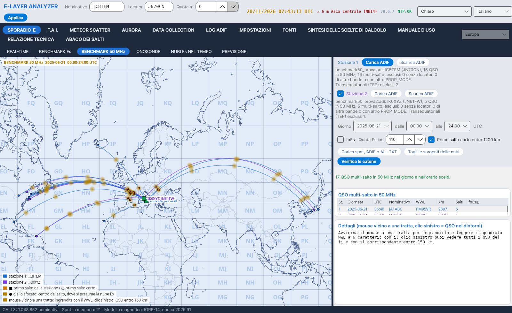
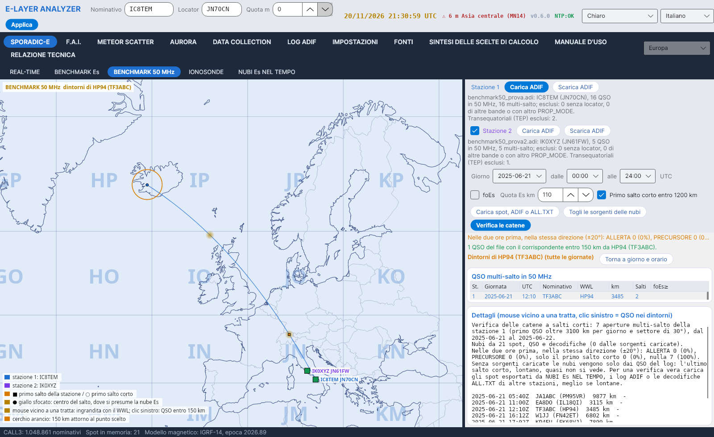

# BENCHMARK 50 MHz

[← หน้าหลัก](Home-th)

แท่นทดสอบสำหรับ **sporadic-E หลายฮอปบน 50 MHz** โดยใช้ล็อก ADIF ของสถานีหนึ่ง และหากต้องการ ของสถานีที่สอง

## การโหลดล็อก

- **สถานี 1**: *โหลด ADIF* / *นำ ADIF ออก* โปรแกรมนำ `STATION_CALLSIGN` และ `MY_GRIDSQUARE` มาจากล็อก; ตำแหน่งที่ส่งคือ `MY_GRIDSQUARE` ของแต่ละ QSO
- **สถานี 2** (ไม่บังคับ): ปุ่มเดียวกันในแถวที่สอง; ช่อง *สถานี 2* ใช้แสดงหรือซ่อน เส้นทางของสถานี 1 เป็นสีฟ้า ของสถานี 2 เป็นสีม่วง
- โปรแกรมใช้ QSO บน 50 MHz ที่มีโลเคเตอร์ (โลเคเตอร์ที่ขาดหายหรือมี 4 ตัวอักษรจะนำมาจาก CALL3) แบบหลายฮอป: เกิน 3100 km (กฎของผู้เขียน; จำนวนฮอปเป็นไปตามตาราง IK3XTV)
- ไม่รวมการติดต่อ**ข้ามเส้นศูนย์สูตร** (กฎของผู้เขียน): สำหรับทิศไปแอฟริกาและอเมริกาใต้ ที่จุดกึ่งกลางอยู่ในแถบมุมเอียงแม่เหล็กระหว่าง -15° ถึง +15° เว้นแต่ล็อกจะมี `PROP_MODE=ES`

## วันและเวลา

เลือก**วัน** (เมื่อเปิดจะเป็นวันที่มี QSO หลายฮอปมากที่สุด) และเวลา **จาก… ถึง…** UTC ทีละ 15 นาที ช่อง **foEs** (ไม่บังคับ) จะระบายสีเส้นทางตาม foEs ต่ำสุดและแสดงไว้ในตาราง

## แผนที่

แผนที่ **Mercator** ที่กำหนดศูนย์กลางได้อิสระ: ล้อเมาส์ = ซูม, ลาก = เลื่อน

- **จุดสีเหลืองจาง**ทำเครื่องหมายศูนย์กลางของทุกฮอป ซึ่งสันนิษฐานว่าเป็นที่อยู่ของเมฆ Es; จุดนี้จะใหญ่ขึ้นบนเส้นทางที่อยู่ใต้เมาส์
- **เมาส์ใกล้เส้นทาง**: เส้นและไอคอนจะขยายใหญ่ขึ้นและปรากฏ**ช่องกริด WWL 6 ตัวอักษร**ของสถานี DX
- **คลิกซ้าย**บนเส้นทางนั้น: ป๊อปอัปจะถามว่าจะแสดง **QSO ทั้งหมดในไฟล์** (ทุกวัน) ที่มีตำแหน่งปลายทาง**ภายใน 150 km** จากจุดนั้นหรือไม่ *ใช่*: แผนที่จะถูกล้างและแสดง QSO เหล่านั้นภายในวงกลมสีส้ม; *ไม่*: แผนที่คงเดิม *กลับไปที่วันและเวลา* จะกลับไปยังการเลือกก่อนหน้า

## รายละเอียด

สำหรับเส้นทางที่เลือก: ระยะทางและการจัดระดับตามตาราง IK3XTV อะซิมุททั้งสองทิศทาง ฮอปเท่ากันพร้อมช่องกริดของจุดสะท้อน ฮอปแรกแบบสั้นภายใน 1200 km (ประสบการณ์ของ IC8TEM) และเมื่อเลือกช่อง foEs จะแสดง foEs ต่ำสุด

## การตรวจสอบสายโซ่ (ตั้งแต่เวอร์ชัน 0.6.0)

**โหลดสปอต, ADIF หรือ ALL.TXT** (สปอตที่ส่งออกจาก เมฆ Es ตามเวลา ล็อก ADIF ของสถานีอื่น การถอดรหัส ALL.TXT ของ JTDX หรือ WSJT-X: นามเรียกขานระบุได้จากแถวการส่ง) และ **ตรวจสอบสายโซ่**: โปรแกรมนำกฎของสายโซ่ฮอปสั้นมาเล่นซ้ำกับการเปิดหลายฮอปของสถานี 1 และเขียนว่าจะแจ้งล่วงหน้าการเปิดได้กี่ครั้ง (การแจ้งเตือน สัญญาณบ่งชี้ล่วงหน้า หรือมีเพียงฮอปสั้นแรก) เวลาล่วงหน้ามัธยฐาน และการแจ้งเตือนที่ไม่มี QSO หลายฮอปตามมา หากไม่ได้โหลดแหล่งข้อมูล เมฆจะมาจากล็อกเท่านั้น และฮอปสั้นสุดท้ายแทบมองไม่เห็น: ต้องใช้ข้อมูลจากสถานีที่อยู่ไกล

