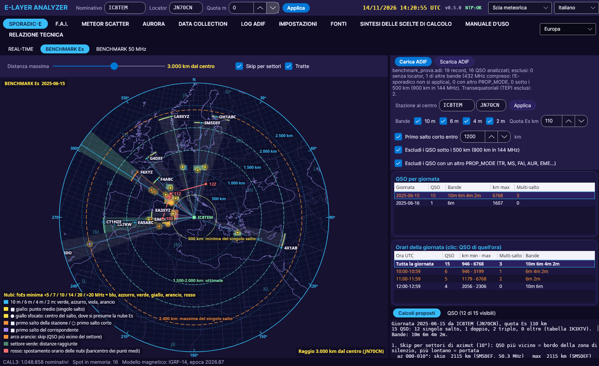
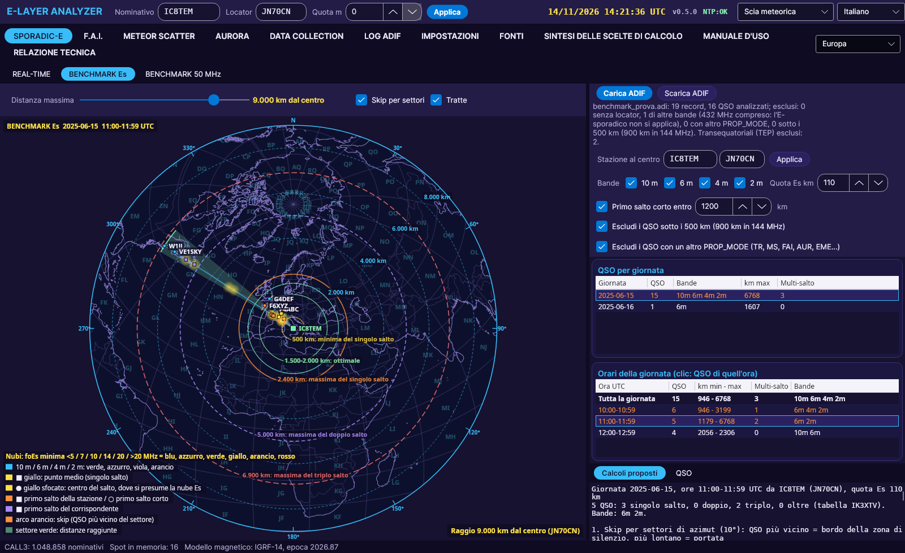

# BENCHMARK Es

[← Home](Home)

Test bench for **sporadic-E** and **multi-hop** on a **whole ADIF log**, even one from another station: from the QSOs actually made, the program sketches the skip and the clouds, day by day and hour by hour.

## Loading the log

- **Load ADIF**: chooses the `.adi`/`.adif` file. The program remembers the file and reloads it at startup.
- **Unload ADIF**: removes the log from the tab.
- **Station at the centre**: callsign and locator of the station that made the log. The program proposes the most frequent `STATION_CALLSIGN` (or `OPERATOR`) and `MY_GRIDSQUARE`; they can be changed by hand and confirmed with **Apply**. The centre does not depend on the general settings, so logs from other stations can be studied.
- Transmitting position: the `MY_GRIDSQUARE` of each QSO (if missing, the locator at the centre). Receiving positions: the `GRIDSQUARE` fields.
- QSOs used: 28, 50, 70 and 144 MHz with a locator. QSOs with another `PROP_MODE` (TR, MS, FAI, AUR, EME...) and those under 500 km can be excluded. 432 MHz is never included: sporadic-E does not apply.

## Days and hours

- **QSOs per day**: day, number of QSOs, bands, maximum distance, multi-hops. On opening, the program proposes the day with the most QSOs.
- **Hours of the day**: the *Whole day* row and one row for each UTC hour; a click shows only the QSOs of that hour.
- **QSO**: the list for the selection; clicking a QSO (or near the DX station on the map) highlights it and shows its details.

## The map

**Azimuthal equidistant** map centred on the station, with the **Maximum distance** slider for zooming (also with the mouse wheel): the rings show the **km from the centre**.

- **Skip by sector** (10° of azimuth): orange arc = closest QSO in the sector (edge of the skip zone), green arc = farthest QSO, in between the area reached.
- **Es clouds** on the Maidenhead squares, coloured by the estimated foEs.
- Midpoint of single hops (yellow), first hop of the station (orange, hollow circle = short first hop), first hop of the DX station (purple).
- For the whole day, the **red line** joins the centroid of the midpoints hour by hour: it is the drift of the clouds.

## Proposed calculations

1. **Skip by sector**: for each sector the skip distance and the range, with the callsigns.
2. **Estimated foEs** with the secant law (foEs ≥ f / sec φ): the shortest single hop on each band gives the highest estimate; with this foEs, the expected MUF at 1000, 1500, 2000 and 2400 km and the distance beyond which 144 MHz would open.
3. **Es clouds** estimated on the squares, with the number of QSOs and the foEs.
4. **Multi-hop**: the station's first hop under the two hypotheses (equal hops, and short first hop within 1200 km, IC8TEM's experience) compared with the clouds seen in single hop within ±30 minutes; within 300 km the hypothesis is confirmed. The program counts the confirmations of each hypothesis.
5. **Cloud drift** hour by hour: km, direction and speed.

The calculations are indicative: a QSO says the path was open, not exactly where the cloud was. The cleaner the data (6-character locators, correct `PROP_MODE`), the more reliable the skip.
