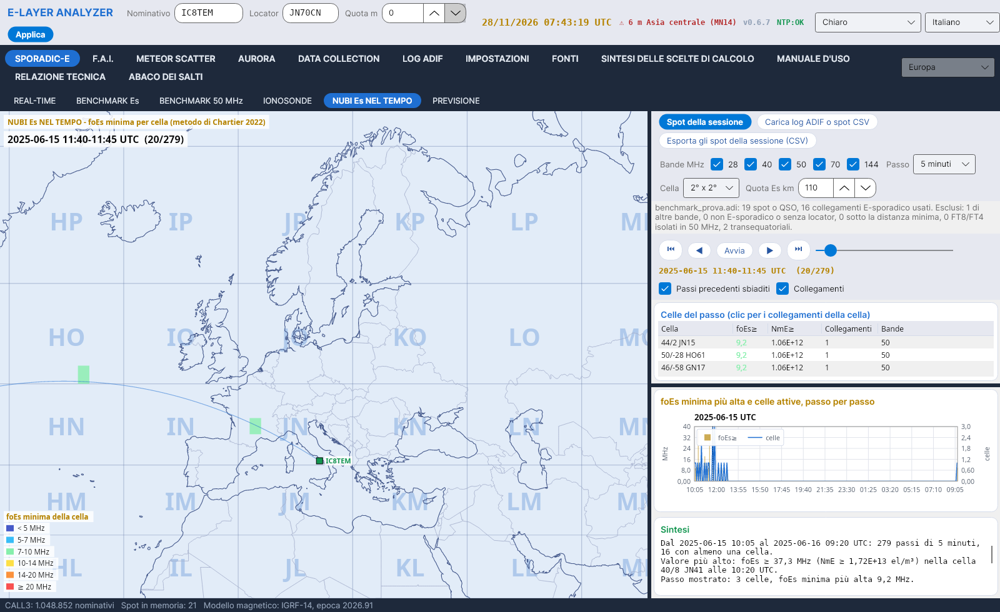

# وقت کے ساتھ Es بادل

[← Home](Home-ur)

**SPORADIC-E** کا ذیلی ٹیب (ورژن 0.5.2 سے): **sporadic-E کے بادل** کیسے بنتے، حرکت کرتے اور ختم ہوتے ہیں، قدم بہ قدم۔

## طریقہ

**Chartier، Hanley اور Emmons (2022)** کا طریقہ: ہر sporadic-E رابطہ بتاتا ہے کہ انعکاسی نقطے پر foEs **کم از کم f / sec φ** ہے۔ نقاط خانوں اور وقت کے قدموں میں جمع کیے جاتے ہیں، اور ہر خانہ قدم کی **سب سے زیادہ قدر** لیتا ہے۔ کم از کم الیکٹران کثافت NmE = 1.24·10¹⁰ · foEs² الیکٹران فی مکعب میٹر ہے۔

پروگرام اپنے ماڈل کے انعکاسی نقاط (تمام ہاپ) استعمال کرتا ہے، صرف وسطی نقطہ نہیں۔ قدر ایک **نچلی حد** ہے: خالی خانے کا مطلب صرف یہ ہے کہ کوئی رابطہ نہیں۔

## ماخذ اور کنٹرول

- **سیشن کے اسپاٹ** (ٹیب کے ہر بار کھلنے پر تازہ ہوتے ہیں) یا **ADIF لاگ یا CSV اسپاٹ لوڈ کریں**۔
- **سیشن کے اسپاٹ برآمد کریں (CSV)**: اسپاٹس کا ذخیرہ پروگرام بند ہونے پر خالی ہو جاتا ہے، اس طرح آپ انہیں بعد میں دیکھ سکتے ہیں۔
- **بینڈ MHz** (28، 40، 50، 70، 144)، **قدم** (5، 10 یا 15 منٹ)، **خانہ** (1°، 2° یا 4°)، **Es اونچائی km**۔
- وقت کی پٹی: ⏮ ◀ *شروع کریں/روکیں* ▶ ⏭ اور سلائیڈر؛ کھلنے پر سب سے زیادہ خانوں والے قدم سے آغاز ہوتا ہے۔
- *پچھلے قدم مدھم* منتخب قدم سے پہلے کے تین قدم دکھاتا ہے؛ *رابطے* راستے بینڈوں کے رنگوں میں بناتا ہے۔

## جدول اور گراف

- قدم کے خانے: خانہ (جنوب مغربی کونا اور مرکز کا لوکیٹر)، foEs≥، NmE≥، رابطے، بینڈ۔ کسی خانے پر کلک: اس کے رابطے نمایاں ہوتے ہیں۔
- گراف: ہر قدم کے لیے سب سے زیادہ کم از کم foEs (پیلی لکیر) اور خانوں کی تعداد (بار)۔
