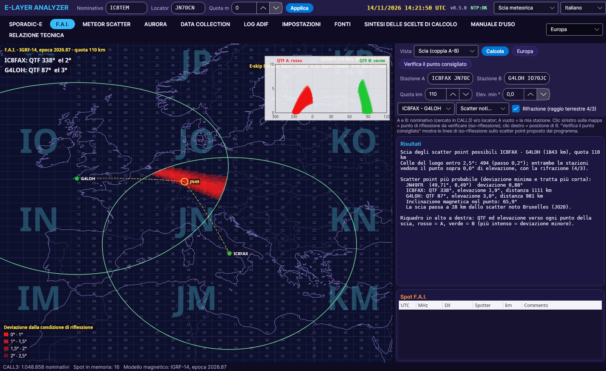
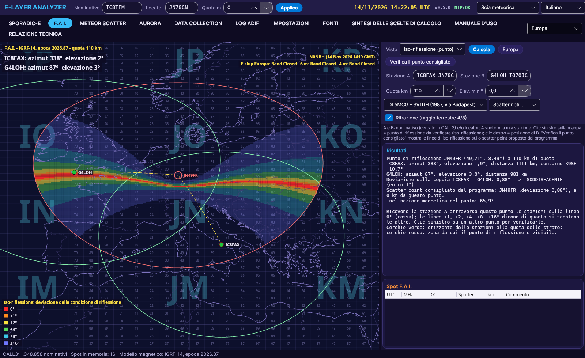

# F.A.I.

[← Home](Home-hi)

F.A.I. (Field Aligned Irregularities, क्षेत्र-संरेखित अनियमितताएँ) भू-चुंबकीय क्षेत्र के साथ संरेखित अनियमितताओं से होने वाला प्रकीर्णन है, जो स्पोरैडिक-E के बाद गर्मियों की शामों में आम है। प्रकीर्णित सिग्नल एक **शंकु** पर निकलता है जिसका अक्ष क्षेत्र की दिशा में है: दो स्टेशन आपस में संपर्क कर सकते हैं यदि वे **संपूरक समोच्च रेखाओं** पर हों (a1 + a2 = 180°, IC8FAX-IC8TEM लेख; K9SE की ±c समोच्च रेखाएँ)। चुंबकीय क्षेत्र की गणना **IGRF-14** मॉडल से होती है।

## Scatter trail दृश्य (A-B जोड़ी)

- **स्टेशन A** और **स्टेशन B** दर्ज करें (CALL3 में खोजा गया कॉलसाइन और/या लोकेटर)। A खाली छोड़ा = आपका अपना स्टेशन।
- मानचित्र **Scatter trail** दिखाता है: परत की ऊँचाई पर वे सभी बिंदु, जिन्हें दोनों स्टेशन देखते हैं और जो 2.5° के भीतर परावर्तन शर्त पूरी करते हैं (वर्ग 0-1, 1-1.5, 1.5-2, 2-2.5°)।
- ऊपर दाएँ का बॉक्स हर बिंदु की ओर A (लाल) और B (हरा) का **QTF और उन्नयन** दिखाता है।
- प्रोग्राम **सबसे संभावित स्कैटर पॉइंट** सुझाता है (न्यूनतम विचलन, सबसे छोटा पथ)।
- **अपवर्तन 4/3**: डिफ़ॉल्ट रूप से चालू, यह क्षितिज को बढ़ाता है।

## आइसोफ्लेक्शन दृश्य (आइसोफ्लेक्शन रेखाएँ)

यह वह ज्यामितीय रचना है जिससे **जाँचा जाता है कि कोई परावर्तन बिंदु सही है या नहीं**।

- मानचित्र पर **बायाँ क्लिक**: जाँचने के लिए बिंदु चुनते हैं। **दायाँ क्लिक**: स्टेशन B को खिसकाता है।
- **अनुशंसित बिंदु जाँचें**: प्रोग्राम द्वारा सुझाए गए बिंदु पर चार्ट खोलता है।
- **0, ±1, ±2, ±4, ±8, ±16°** पर समोच्च रेखाएँ: गहरी योजनाओं में रंगीन पट्टियाँ, हल्की योजनाओं में **मोटी रेखाएँ**।
- जोड़ी पर निर्णय: 1° के भीतर **संतोषजनक**, 2.5° के भीतर **स्वीकार्य**, उससे आगे **असंतोषजनक**।
- यदि बिंदु किसी स्टेशन के क्षितिज से नीचे हो, तो केवल **गणना संभव नहीं** पॉपअप दिखता है और कुछ नहीं।

## जाँचें

| संपर्क | स्कैटर पॉइंट | विचलन | QTF |
|---|---|---|---|
| IC8FAX - F6DRO | JN44GH (जेनोआ के ऊपर) | 0.97° | 314° / 77° |
| IC8FAX - G4LOH | JN49FR (दक्षिण-पश्चिम जर्मनी, ब्रसेल्स से 28 km) | 0.88° | 338° / 87° |
| बीकन DB0FAI (305°) - Dresden, Sheffield के रास्ते (DL5MCG; Dresden की दिशा 290° थी और ऑरोरा बताया गया) | – | 0.3° | – |
| IC8FAX - FA1MXE (1990, 1990 का IGRF क्षेत्र) | JN45MV, Scatter trail जिनेवा से 40 km (जिनेवा: 4.10°) | 0.76° | 326° / 85° |
| DL5MCG - SV1DH (1987 का परीक्षण बुडापेस्ट के रास्ते, 1569 km, 1987 का IGRF क्षेत्र) | बुडापेस्ट 2.53° पर, 2.5° से थोड़ा अधिक (आज के क्षेत्र के साथ 2.16°); Scatter trail 26 km पर; सबसे संभावित KN06RV | 2.53° (KN06RV 0.93°) | 95° / 341° |

संस्करण 0.4.18 से तिथि वाले दो मामले (1987 और 1990) उसी वर्ष के IGRF-14 क्षेत्र का उपयोग करते हैं, जब तक स्टेशन उसी मामले के रहें।

सूची में ज्ञात स्कैटर पॉइंट: जिनेवा, ब्रसेल्स, बुडापेस्ट, JN92, JN41/42।

**जाँचें...** मेनू परीक्षण युग्म IC8FAX-F6DRO, IC8FAX-G4LOH, IC8FAX-FA1MXE और DL5MCG-SV1DH लोड करता है।

**उपकरण** (DL5MCG): 144 MHz में F.A.I. के लिए कम से कम एक लंबा यागी और 100 W चाहिए (SV1DH से 8 एलिमेंट यागी और 50 W के साथ भी संपर्क हुआ)। ऐंटेना को प्रोग्राम द्वारा बताए गए स्कैटर पॉइंट की ओर लक्षित करें, दूसरे स्टेशन की ओर नहीं।
