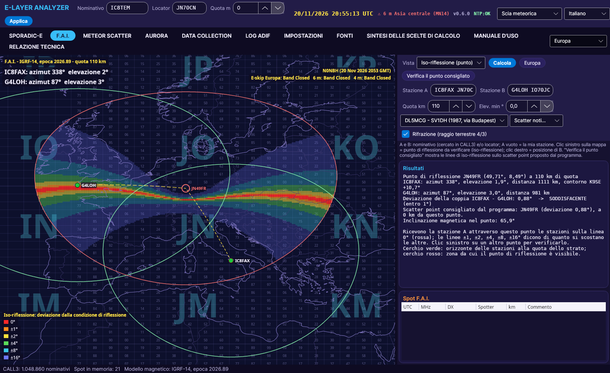

# F.A.I.

[← Home](Home-lt)

F.A.I. (Field Aligned Irregularities) – tai sklaida nuo išilgai geomagnetinio lauko išsidėsčiusių netolygumų, būdinga vasaros vakarams po sporadinio E. Išsklaidytas signalas sklinda **kūgiu**, kurio ašis nukreipta išilgai lauko: dvi stotys gali užmegzti ryšį, jei jos yra ant **papildomų kontūrų** (a1 + a2 = 180°, IC8FAX ir IC8TEM straipsnis; K9SE ±c kontūrai). Magnetinis laukas skaičiuojamas pagal modelį **IGRF-14**.

**F.A.I. įspėjimas** (nuo 0.6.5 versijos): nuo gegužės iki rugsėjo, tarp 18 ir 24 val. vietos laiku, po Es debesies 300-1300 km nuo jūsų stoties kortelė **mirksi**, o raudona eilutė viršuje nurodo, kur F.A.I. galimas (straipsnio IC8FAX-IC8TEM taisyklės); esant naujiems F.A.I. spotams, ji nurodo, kad jis vyksta. Spustelėjus eilutę: vaizdas Izoatspindys ties tašku.

## Vaizdas Scatter trail (pora A-B)

- Įveskite **Stotis A** ir **Stotis B** (šaukinys ieškomas CALL3 ir (arba) lokatorius). Tuščias A = jūsų stotis.
- Žemėlapis rodo **Scatter trail**: visus sluoksnio aukštyje esančius taškus, matomus iš abiejų stočių, kurie tenkina atspindžio sąlygą 2,5° ribose (klasės 0-1, 1-1,5, 1,5-2, 2-2,5°).
- Langelis viršuje dešinėje rodo A (raudona) ir B (žalia) **QTF ir elevaciją** į kiekvieną tašką.
- Programa siūlo **labiausiai tikėtiną sklaidos tašką** (mažiausias nuokrypis, trumpiausia trasa).
- **Refrakcija 4/3**: įjungta pagal nutylėjimą, išplečia horizontus.

## Vaizdas Izoatspindys (izoatspindžio linijos)

Tai geometrinė konstrukcija, naudojama **patikrinti, ar atspindžio taškas teisingas**.

- **Kairysis spustelėjimas** žemėlapyje: pasirenkate tikrinamą tašką. **Dešinysis spustelėjimas**: perkelia stotį B.
- **Patikrinti rekomenduojamą tašką**: atveria diagramą su programos siūlomu tašku.
- Kontūrinės linijos ties **0, ±1, ±2, ±4, ±8, ±16°**: tamsiose schemose spalvotos juostos, šviesiose schemose **storos linijos**.
- Poros vertinimas: **tenkina** iki 1°, **priimtina** iki 2,5°, **netenkina** daugiau.
- Jei taškas yra žemiau vienos stoties horizonto, pasirodo iššokantis langas **Skaičiuoti negalima** ir nieko daugiau.

## Patikros

| Ryšys | Sklaidos taškas | Nuokrypis | QTF |
|---|---|---|---|
| IC8FAX - F6DRO | JN44EH (virš Genujos) | 0,96° | 313° / 77° |
| IC8FAX - G4LOH | JN49BR (pietvakarių Vokietija, 18 km nuo Briuselio) | 0,93° | 337° / 88° |
| Švyturys DB0FAI (305°) - Drezdenas per Šefildą (DL5MCG; Drezdenas buvo nukreipęs anteną 290° ir nurodė pašvaistę) | – | 0,3° | – |
| IC8FAX - FA1MXE (1990, 1990 m. IGRF laukas) | JN45QR, pėdsakas 35 km nuo Ženevos (Ženeva: 3,79°) | 0,92° | 327° / 87° |
| DL5MCG - SV1DH (1987 m. bandymas per Budapeštą, 1569 km, 1987 m. IGRF laukas) | Budapeštas ties 2,22°, neviršija 2,5° (1,85° su šiandienos lauku); pėdsakas už 21 km; labiausiai tikėtinas KN06TQ | 2,22° (KN06TQ 0,92°) | 95° / 341° |

Nuo 0.4.18 versijos du atvejai su data (1987 ir 1990) naudoja tų metų IGRF-14 lauką, kol stotys lieka tos pačios kaip atvejo.

Žinomi sklaidos taškai sąraše: Ženeva, Briuselis, Budapeštas, JN92, JN41/42.

Meniu **Patikros...** įkelia bandomąsias poras IC8FAX-F6DRO, IC8FAX-G4LOH, IC8FAX-FA1MXE ir DL5MCG-SV1DH.

**Įranga** (DL5MCG): F.A.I. 144 MHz juostoje reikia bent ilgos yagi ir 100 W (su SV1DH buvo dirbta ir su 8 elementų yagi bei 50 W). Nukreipkite anteną į programos nurodytą sklaidos tašką, o ne į kitą stotį.
