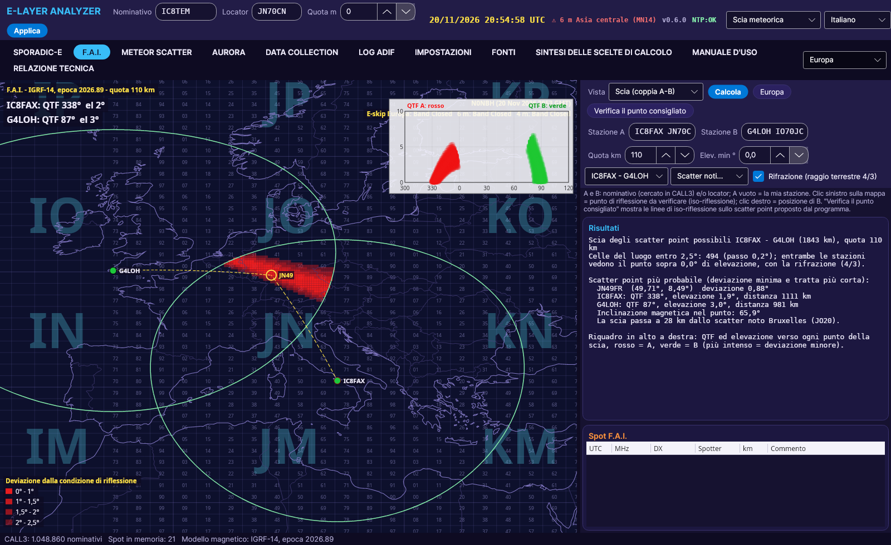

# F.A.I.

[← Home](Home-tr)

F.A.I. (Field Aligned Irregularities, alan hizalı düzensizlikler), yer manyetik alanı boyunca hizalanmış düzensizliklerden gelen saçılmadır; yaz akşamlarında sporadik E'nin ardından tipiktir. Saçılan sinyal ekseni alan doğrultusunda olan bir **koni** üzerinde yayılır: iki istasyon **tümler konturlar** üzerinde bulunuyorsa birbiriyle çalışabilir (a1 + a2 = 180°, IC8FAX-IC8TEM makalesi; K9SE'nin ±c konturları). Manyetik alan **IGRF-14** modeliyle hesaplanır.

**F.A.I. uyarısı** (0.6.5 sürümünden itibaren): Mayıs'tan Eylül'e, yerel saatle 18 ile 24 arasında, istasyonunuza 300-1300 km'deki bir Es bulutundan sonra sekme **yanıp söner** ve üstteki kırmızı satır F.A.I.'nin nerede mümkün olduğunu söyler (IC8FAX-IC8TEM makalesinin kuralları); güncel F.A.I. spot'larıyla sürdüğünü söyler. Satıra tıklama: noktada İzo-yansıma görünümü.

## Scatter trail görünümü (A-B çifti)

- **A istasyonu** ve **B istasyonunu** girin (CALL3'te aranan çağrı işareti ve/veya lokatör). A boş bırakılırsa = kendi istasyonunuz.
- Harita **scatter trail**'i gösterir: katman yüksekliğinde, iki istasyonun da gördüğü ve yansıma koşulunu 2,5° içinde sağlayan tüm noktalar (sınıflar 0-1, 1-1,5, 1,5-2, 2-2,5°).
- Sağ üstteki kutu, A'nın (kırmızı) ve B'nin (yeşil) her noktaya doğru **QTF ve elevasyonunu** gösterir.
- Program **en olası scatter point**'i önerir (en küçük sapma, en kısa yol).
- **Kırılma 4/3**: varsayılan olarak açıktır, ufukları genişletir.

## İzo-yansıma görünümü (izo-yansıma eğrileri)

Bu, **bir yansıma noktasının doğru olup olmadığını denetlemek** için kullanılan geometrik yapıdır.

- Haritaya **sol tık**: denetlenecek noktayı seçersiniz. **Sağ tık**: B istasyonunu taşır.
- **Önerilen noktayı doğrula**: grafiği programın önerdiği nokta üzerinde açar.
- **0, ±1, ±2, ±4, ±8, ±16°**'de kontur çizgileri: koyu şemalarda renkli şeritler, açık şemalarda **kalın çizgiler**.
- Çift hakkında hüküm: 1° içinde **tatmin edici**, 2,5° içinde **kabul edilebilir**, ötesinde **tatmin edici değil**.
- Nokta istasyonlardan birinin ufkunun altındaysa yalnızca **Hesaplama yapılamıyor** açılır penceresi çıkar.

## Doğrulamalar

| Bağlantı | Scatter point | Sapma | QTF |
|---|---|---|---|
| IC8FAX - F6DRO | JN44EH (Cenova üzerinde) | 0,96° | 313° / 77° |
| IC8FAX - G4LOH | JN49BR (GB Almanya, Brüksel'e 18 km) | 0,93° | 337° / 88° |
| DB0FAI beaconı (305°) - Sheffield üzerinden Dresden (DL5MCG; Dresden 290°'ye yönlendirmişti ve aurora bildirmişti) | – | 0,3° | – |
| IC8FAX - FA1MXE (1990, 1990 IGRF alanı) | JN45QR, iz Cenevre'ye 35 km (Cenevre: 3,79°) | 0,92° | 327° / 87° |
| DL5MCG - SV1DH (Budapeşte üzerinden 1987 testi, 1569 km, 1987 IGRF alanı) | Budapeşte 2,22°'de, 2,5° sınırı içinde (bugünkü alanla 1,85°); iz 21 km'de; en olası KN06TQ | 2,22° (KN06TQ 0,92°) | 95° / 341° |

0.4.18 sürümünden itibaren tarihi olan iki örnek (1987 ve 1990), istasyonlar örnektekiler olarak kaldığı sürece o yılın IGRF-14 alanını kullanır.

Listedeki bilinen scatter point'ler: Cenevre, Brüksel, Budapeşte, JN92, JN41/42.

**Doğrulamalar...** menüsü IC8FAX-F6DRO, IC8FAX-G4LOH, IC8FAX-FA1MXE ve DL5MCG-SV1DH test çiftlerini yükler.

**Donanım** (DL5MCG): 144 MHz'de F.A.I. için en az uzun bir yagi ve 100 W gerekir (SV1DH 8 elemanlı bir yagi ve 50 W ile de çalışılmıştır). Anteni karşı istasyona değil, programın verdiği scatter point'e yönlendirin.
