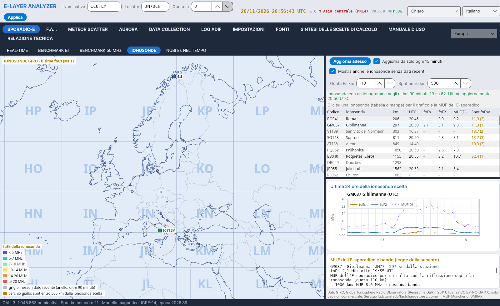

# JONOSONDER

[← Home](Home-sv)

Underflik till **SPORADIC-E** (från version 0.5.2): den **uppmätta foEs** från jonosonderna i **GIRO**-nätet i hela världen, bredvid den som programmet härleder ur spotsen.

## Data

- 63 GIRO-jonosonder (ULCAR-listan), med den senaste **foEs**, **foF2** och **MUF(D)** avlästa automatiskt från jonogrammen.
- Data kommer första gången fliken öppnas och sedan **var 15:e minut** av sig själva (kryssrutan *Uppdatera automatiskt var 15:e minut*); *Uppdatera nu* hämtar dem direkt. Arkivet sparar de senaste 48 timmarna i mappen `giro` bland data.
- Data från **GIRO** (Reinisch och Galkin 2011), licens **CC BY-NC-SA 4.0**: endast icke-kommersiell användning. Tjänsten är densamma som i *MUF Muncher* av DM6AX.

## Karta och tabell

- Varje jonosond är en färgad prick med den senaste foEs (samma färger som Es-molnen) och värdet i MHz; **grå** om den inte har nya data, med **ring** om det senaste jonogrammet är äldre än 90 minuter.
- Tabell: Kod, Jonosond, km från din station, UTC för det senaste jonogrammet, foEs, foF2, MUF(D) och **Spots foEs≥**: den minsta foEs härledd ur Es-spots från de senaste 30 minuterna som reflekteras inom 500 km från jonosonden (justerbart), med antalet spots.

## Den valda jonosonden

Klicka på en rad eller nära en jonosond på kartan:

- **diagram över de senaste 24 timmarna**: foEs gul, foF2 ljusblå, MUF(D) lila prickad;
- **MUF för sporadiskt E** vid 1000, 1500, 2000 och 2400 km (MUF = foEs · sec φ, på den valda Es-höjden) med de **band som öppnar** (28, 40, 50, 70, 144 MHz);
- om spotsen kräver mer än den uppmätta foEs påpekar programmet det: molnet kan ligga långt från jonosonden, eller så har jonosonden nått gränsen för sitt frekvensområde (Chartier 2022).
