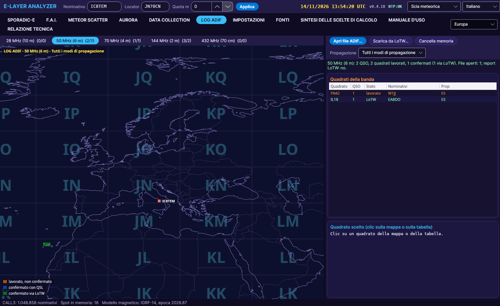

# LOG ADIF

[← Home](Home-ro)

- **Deschide fișier ADIF...** (sunt permise mai multe fișiere) sau **Descarcă din LoTW...** (nume de utilizator și parolă; parola nu se salvează niciodată).
- O filă pentru fiecare bandă **de la 28 MHz în sus**, fiecare separat, **fără agregare**; alături: pătrate lucrate / confirmate.
- Culori: **portocaliu** = lucrat, **albastru** = confirmat prin QSL, **verde** = confirmat prin LoTW.
- Filtru după **modul de propagare** din log (PROP_MODE: ES, FAI, AUR/AUE, MS, TR, EME, F2).
- Clic pe un pătrat: lista QSO-urilor cu dată, oră, mod și confirmare, distanță și azimut.
- **Golește memoria**: elimină fișierele deschise și raportul LoTW.
