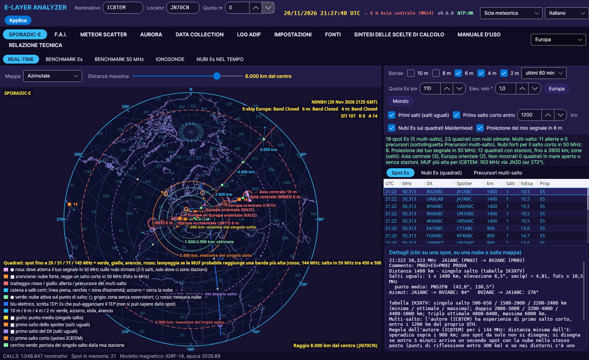

# SPORADIC-E

[← Home](Home-ar)

## الخريطة

زر فوق الخريطة يختار المنظر:

- **سمتي**: خريطة سمتية متساوية المسافات متمركزة على محطتك، مع منزلق **التكبير** (من 300 إلى 20000 km من المركز، وبعجلة الفأرة أيضًا).
- **ميركاتور**: خريطة العالم، مع زرّي أوروبا والعالم.

في كلا الإسقاطين تُرسم حول المحطة **دوائر المسافات لـ Flavio IK3XTV**: 500 km (الحد الأدنى للقفزة الواحدة)، 1500-2000 km (المسافة المثلى)، 2400 km (الحد الأقصى للقفزة الواحدة)، 5000 km (الحد الأقصى للقفزة المزدوجة) و6900 km (الحد الأقصى للقفزة الثلاثية).

في المناظر السمتية تبيّن الحلقات المتقطعة **الكيلومترات من المركز** (تتغير الخطوة مع التكبير)، وتعلّم الحافة أقصى مسافة معروضة، ويعطي مؤشر الفأرة المسافة والسمت من المركز.

## ما تعرضه

- **البلاغات** في الدقائق الأخيرة (15 min - 12 h) على نطاقات **28 و40 ‏(8 m، معطّل افتراضياً) و50 و70 و144 MHz**، المأخوذة من جلسات telnet. تؤخذ محددات الموقع من تعليق البلاغ (مثلاً `JN70CN<ES>JO62QM`) أو من قاعدة بيانات CALL3.
- البلاغات التي تحوي **<MS>** أو **<AU>** أو **<TR>** في نصها **تُستبعد**: فهي لا تخص الطبقة E المتفرقة، لكنها مفيدة للتشتت النيزكي أو الشفق أو الانتشار التروبوسفيري.
- **العابر لخط الاستواء، قاعدة المؤلف (IC8TEM)**: نحو أفريقيا وأمريكا الجنوبية، إذا وقعت نقطة المنتصف في نطاق الميل المغناطيسي بين -15° و+15° ‏(قيمة مأخوذة من Cracknell، UKSMG: مناطق TEP على نحو 5-15° من خط الميل الصفري)، فالاتصال عابر لخط الاستواء (TEP) وليس طبقة E متفرقة، ما لم يذكر البلاغ `<ES>`.
- **144 MHz، قاعدة المؤلف (IC8TEM)**: تبدأ الطبقة E المتفرقة على نطاق 2 m **بعد 900 km** (تُستبعد البلاغات الأقصر). البلاغ المنفرد على 144 MHz **لا يُرسم وحده**: يظهر عندما يصل خلال **5 دقائق** بلاغ ثانٍ على 144 MHz مع السحابة في المكان نفسه (نقاط الانعكاس ضمن 300 km)، أو عندما يوجد بلاغ **قفزة قصيرة على 50 MHz** قريب (ضمن 1200 km، في آخر 15 دقيقة). يبيّن الشريط في الأعلى عدد بلاغات 144 MHz التي تنتظر التأكيد.
- لكل بلاغ: المسافة، و**عدد القفزات** وفق جدول **IK3XTV**، وزاوية الارتفاع، و**الحد الأدنى لـ foEs** (قانون القاطع).
- **القفزة الأولى لكلتا المحطتين**: المربع البرتقالي = القفزة الأولى للمُبلِّغ، والبنفسجي = القفزة الأولى للمحطة المقابلة (قفزات متساوية)؛ والأصفر = نقطة منتصف القفزة الواحدة.
- **القفزة الأولى القصيرة** (دوائر مجوفة): في الانفتاحات متعددة القفزات لاحظ المؤلف بالتجربة قفزة أولى قصيرة ضمن **1200 km** من محطته؛ ويمكن ضبط الطول.
- **سحب Es** على **مربعات Maidenhead** (2° x 1°)، ملونة بحسب الحد الأدنى لـ foEs: أزرق < 5، أزرق فاتح < 7، أخضر < 10، أصفر < 14، برتقالي < 20، أحمر > 20 MHz.
- جدول **سحب Es**: لكل مربع، **MUF لمحطتك** (أحمر = 144 MHz ممكن، برتقالي = 70، أصفر = 50).

## جدول IK3XTV

| | الحد الأدنى | المثالي | الحد الأقصى |
|---|---|---|---|
| قفزة واحدة | 500-650 km | 1500-2000 km | 2200-2400 km |
| قفزة مزدوجة | 2800-3000 km | 3200-4000 km | 4400-5000 km |
| قفزة ثلاثية | – | 4800-6400 km | 6900 km |

## طريقة الاستخدام

- **انقر على بلاغ**: يُبرَز المسار، مع نقاط الانعكاس ومحددات الموقع والسمت في التفاصيل.
- **انقر على بلاغ** في الجدول: يضيء المسار على الخريطة (توهج أصفر)، وإذا كان خارج المنظر تتحرك الخريطة أو توسّع نصف قطرها لإظهاره. يبقى البلاغ محدداً عند وصول بلاغات جديدة.
- **الجدول يتبع الخريطة**: عند ضبط تكبير ما، لا يعرض جدول البلاغات وجدول السحب إلا ما هو ظاهر على الخريطة.
- **انقر على الخريطة**: تُعامل النقطة كسحابة Es محتملة، مع قيم foEs اللازمة لـ 28 و50 و70 و144 MHz.

## ملاحظة حول 432 MHz

الطبقة E المتفرقة **لا تنطبق على 432 MHz**: يبلغ MUF للطبقة Es نحو 150-200 MHz، ولا تسجل أرقام ARRL القياسية اتصالات Es إلا على 50 و144 MHz. لا تُحلَّل هنا بلاغات 70 cm.

## مربعات ملوّنة حسب التردد ووميض MUF

تُلوَّن مربعات Maidenhead لنقاط الانعكاس حسب أعلى تردد للبلاغات: **أخضر** حتى 29 MHz، و**أصفر** حتى 51، و**برتقالي** حتى 71، و**أحمر** حتى 145 MHz. ومن foEs المربع يُقدَّر MUF المحتمل على أطول قفزة (2400 km، جدول IK3XTV): فإذا بلغ نطاقاً أعلى **يومض** المربع بلون ذلك النطاق (مبدأ IK3XTV وJacobs-Leinwoll: الـ skip القصير يعني MUF مرتفعاً). وعلى 144 MHz تسري قاعدة المؤلف: لا يومض المربع بالأحمر إلا إذا أعطت السحابة قفزة واحدة على 50 MHz بين 450 و500 km ‏(450 km مع تفاوت 50 km).

يظهر في أعلى يمين الخريطة ملخص N0NBH ‏(E-skip للقارة المختارة، وSFI، والمؤشران K وA).

## القواعد حسب النطاق (الإصدار 0.4.18)

- **50 MHz**: لا طبقة E متفرقة ضمن 450 km. بلاغات FT8 وFT4 لا تكون طبقة E متفرقة إلا إذا كانت جزءاً من سحابة: بلاغ آخر على 50 MHz خلال 4 دقائق بنقطة منتصف ضمن 150 km. وبلاغ FT8/FT4 المنفرد يذهب إلى التشتت النيزكي.
- **70 MHz**: لا طبقة E متفرقة ضمن 450 km. يذهب FT8 وFT4 إلى الطبقة E المتفرقة حتى داخل نافذة التشتت النيزكي في خطة النطاق (يقرّر النمط المعروف أولاً، ثم التردد).
- **40 MHz ‏(8 m)**: المسافة الدنيا مستخرجة من الـ 450 km لنطاق 50 MHz بقانون القاطع (نحو 330 km)؛ ولا تُقبل إلا المسافات ضمن القفزة الأولى لهندسة الطبقة E ‏(نحو 2440 km). لون المسار: أصفر.
- **144 MHz**: طبقة E متفرقة من 900 km، مع تأكيد؛ وبلاغات Q65 وJT65 هي EME وتُستبعد، إلا إذا وُجد `<ES>` في النص.
- يرى G0ISW ‏(Propagation identification، 2024) أقصر طبقة E متفرقة أبعد من 400 km على 50 و70 MHz وأبعد من 1400 km على 144 MHz: تتفق قواعد المؤلف معه على 50 و70 MHz وهي أوسع على 144 MHz، لكنها تطلب تأكيداً.
- يظهر ترتيب تطبيق كل القواعد، مع القيم المستخدمة، في **[الإعدادات](Settings-ar)** › توزيع البلاغات.

## سلاسل القفزات القصيرة (منذ الإصدار 0.6.0)

في التبويب الفرعي **مؤشرات تعدد القفزات المبكرة** يبحث البرنامج عن سلاسل تعدد القفزات على 50 MHz وفق شروط المؤلف الثلاثة: **القفزة القصيرة الأولى والأخيرة** (500-1200 km) مع MUF نحو 50 MHz، وتتطلبان foEs بين 11 و21 MHz، و**القفزات الوسطى** حتى 2200 km، وتتطلب نحو 9,3 MHz.

- **السحب القوية** (المربعات البرتقالية): بلاغات Es من العالم كله ومسابر GIRO بقيمة foEs لا تقل عن 11,3 MHz.
- **من QTH**: قفزة قصيرة أولى من محطتك وقفزة قصيرة أخيرة إلى سحابة قوية أخرى على امتداد الاتجاه نفسه، حتى في القارة نفسها (مثلاً في كازاخستان)؛ الدائرة هي منطقة الوصول.
- **الممر**: أي سحابتين قويتين، في أي اتجاه، مثلاً **الكاريبي - شبه الجزيرة الإيبيرية** أو **أوروبا - غرب أفريقيا** (باستثناء TEP)؛ «يعنيك» إذا كان أحد الطرفين ضمن 1200 km منك.
- **ابحث عن السحابة**: لا توجد إلا القفزة القصيرة الأولى؛ تبيّن المناطق الزرقاء الفاتحة أين يُفترض أن تقع سحابة القفزة القصيرة الأخيرة.
- **تنبيه** إذا كانت القفزات الوسطى مغطاة بالسحب، و**مؤشر مبكر** إذا لم ينقص إلا مناطق بلا راصدين.
- في الإعدادات يوجد **الإشعار** في الأعلى (ونافذة اختيارياً) للتنبيهات التي تعنيك.
- لا تُعرض السلاسل التي تصل إلى **عرض البحر** أو حيث لا توجد محطات (CALL3 والبلاغات).
- **قفزة مزدوجة متساوية** (منذ الإصدار 0.6.3، القفزات «2 =»): حتى نحو 4700 km، مثلًا نحو كازاخستان، مع السحابة عند ربع المسار كما في طريقة ITU-R P.534-6.
- يلخص تبويب **جدول القفزات** كم قفزة يلزم على 50 MHz من 500 إلى 12000 km، مع foEs كل قفزة والمصادر.
- **بصمة إشارتي على 6 m**‏ (النقاط الوردية): أين تهبط إشارتك على 50 MHz بعد 2-5 قفزات، فوق سحب آخر 30 دقيقة المقدَّرة من بلاغات جميع النطاقات (28-144 MHz) ومن مسابر الأيونوسفير؛ فقط حيث توجد محطات.
- **ممر القفزات المتساوية** (منذ الإصدار 0.6.5): سحابتان تفصل بينهما 1400-2350 km تربطان منطقتين على 2800-4700 km بقفزتين متساويتين؛ ويؤكد التحقق على بعثة 5U5K الحد عند نحو 4700 km.
- **بادرة** (أخضر، منذ الإصدار 0.6.5): سحابة Es على 28 أو 24 MHz حيث لم ينفتح 50 MHz بعد؛ في الاختبارات انفتح 50 MHz هناك خلال ساعة في 50% من الحالات (30% بدونها)، قبل 9-16 دقيقة.
- **APRS متكرر** (أحمر، منذ الإصدار 0.6.5): قفزتا APRS على الأقل على 2 m أبعد من 900 km عبر السحابة نفسها خلال 10 دقائق = تنبيه 144 MHz؛ ويومض التبويب.
- **ما قيمة التنبيهات** (على محطة المؤلف، صيف 2024-2026): نجحت التنبيهات بنسبة 41-57% (QSO متعدد القفزات في الاتجاه نفسه خلال ساعة) مقابل 5-7% بلا تنبيه؛ لكن 47% من الفتحات تأتي بلا إنذار. وتصل البصمة إلى حدود 500 km من المحطة البعيدة في 13,5% من الفتحات، مقابل 2-4% إذا أُديرت.
- **لا تُحرَّك** السحب: يبين اختبار 22/11/2026 أن تحريكها بسرعتها لا يحسّن التنبؤ على 15-45 دقيقة.
- **التنبؤ بـ TEP** (أزرق، منذ الإصدار 0.6.5): مؤشر 0-100 نحو المناطق وراء خط الاستواء المغناطيسي = الموسم × SFI × Kp (eTEP فقط) × التوقيت المحلي × foF2 لمسابر GIRO؛ يزن SFI ولا يصفّر، لأن TEP يصبح نادرًا عند الحد الأدنى الشمسي لكنه لا يختفي.

