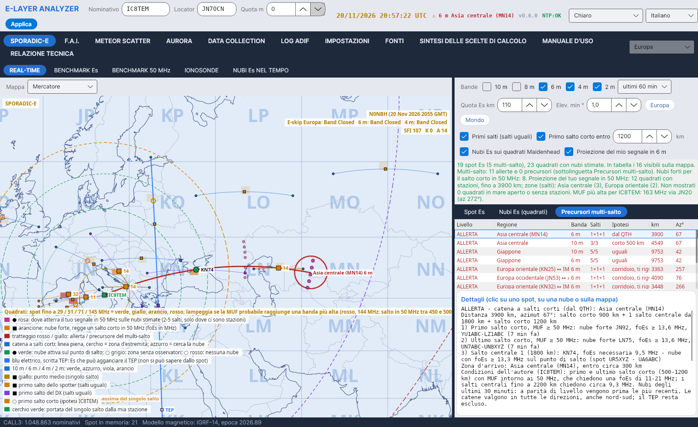
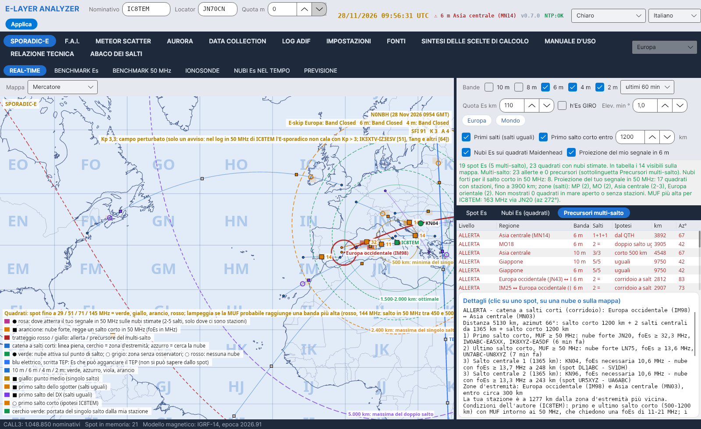

# SPORADIC-E

[← Home](Home-bn)

## মানচিত্র

মানচিত্রের ওপরের একটি বোতাম দৃশ্য বেছে নেয়:

- **অ্যাজিমুথাল**: আপনার স্টেশনকে কেন্দ্র করে অ্যাজিমুথাল সমদূরবর্তী মানচিত্র, **জুম** স্লাইডারসহ (কেন্দ্র থেকে 300 থেকে 20000 km, মাউসের চাকা দিয়েও)।
- **Mercator**: বিশ্ব-মানচিত্র, ইউরোপ ও বিশ্ব বোতামসহ।

দুই প্রক্ষেপেই স্টেশনের চারপাশে **Flavio IK3XTV-এর দূরত্ব-বৃত্ত** আঁকা হয়: 500 km (একক হপের ন্যূনতম), 1500-2000 km (সর্বোত্তম), 2400 km (একক হপের সর্বোচ্চ), 5000 km (দ্বৈত হপের সর্বোচ্চ) এবং 6900 km (ত্রৈত হপের সর্বোচ্চ)।

অ্যাজিমুথাল দৃশ্যে ড্যাশ দেওয়া বলয়গুলো **কেন্দ্র থেকে km** দেখায় (জুম অনুযায়ী ধাপ বদলায়), কিনারা দেখানো সর্বোচ্চ দূরত্ব চিহ্নিত করে, এবং মাউস কার্সর কেন্দ্র থেকে দূরত্ব ও অ্যাজিমুথ দেয়।

## কী দেখায়

- টেলনেট সেশন থেকে নেওয়া, **28, 40 (8 m, প্রাথমিকভাবে বন্ধ), 50, 70 ও 144 MHz** ব্যান্ডে শেষ কয়েক মিনিটের (15 মিনিট - 12 ঘণ্টা) **স্পট**। লোকেটর আসে স্পটের মন্তব্য থেকে (যেমন `JN70CN<ES>JO62QM`) অথবা CALL3 ডেটাবেস থেকে।
- লেখায় **<MS>**, **<AU>** বা **<TR>** থাকা স্পট **বাদ দেওয়া হয়**: এগুলো স্পোরাডিক-E-র নয়, তবে মিটিওর স্ক্যাটার, অরোরা বা ট্রপোর জন্য কাজের।
- **ট্রান্সইকুয়েটোরিয়াল, লেখকের নিয়ম (IC8TEM)**: আফ্রিকা ও দক্ষিণ আমেরিকার দিকে, মধ্যবিন্দু যদি -15° ও +15°-এর মধ্যকার চৌম্বক নতি-বলয়ে (মানটি Cracknell, UKSMG থেকে নেওয়া: TEP-এর অঞ্চল শূন্য নতির রেখা থেকে প্রায় 5-15° দূরে) পড়ে, তবে যোগাযোগটি ট্রান্সইকুয়েটোরিয়াল (TEP), স্পোরাডিক-E নয় – যদি না স্পটে `<ES>` উল্লেখ থাকে।
- **144 MHz, লেখকের নিয়ম (IC8TEM)**: 2 m-এ স্পোরাডিক-E শুরু হয় **900 km-এর বেশি** দূরত্বে (ছোটগুলো বাদ দেওয়া হয়)। একটি একক 144 MHz স্পট **একা আঁকা হয় না**: এটি দেখা যায় যখন **5 মিনিটের** মধ্যে একই জায়গায় মেঘসহ আরেকটি 144 MHz স্পট আসে (প্রতিফলন বিন্দু 300 km-এর মধ্যে), অথবা কাছে একটি **ছোট-হপের 50 MHz** স্পট থাকে (1200 km-এর মধ্যে, শেষ 15 মিনিটে)। ওপরের বার দেখায় কতগুলো 144 MHz স্পট নিশ্চিতকরণের অপেক্ষায় আছে।
- প্রতিটি স্পটের জন্য: দূরত্ব, **IK3XTV** সারণি অনুযায়ী **হপের সংখ্যা**, এলিভেশন, **ন্যূনতম foEs** (সেক্যান্ট সূত্র)।
- **দুই স্টেশনের প্রথম হপ**: কমলা বর্গ = স্পটারের প্রথম হপ, বেগুনি = DX-এর প্রথম হপ (সমান হপ); হলুদ = একক হপের মধ্যবিন্দু।
- **ছোট প্রথম হপ** (ফাঁপা বৃত্ত): মাল্টি-হপ খোলার সময় লেখক নিজের QTH থেকে **1200 km**-এর মধ্যে একটি ছোট প্রথম হপের অভিজ্ঞতা পেয়েছেন; দৈর্ঘ্যটি নির্ধারণ করা যায়।
- **Maidenhead বর্গে** (2° x 1°) **Es মেঘ**, ন্যূনতম foEs অনুযায়ী রঙিন: নীল < 5, আসমানি < 7, সবুজ < 10, হলুদ < 14, কমলা < 20, লাল > 20 MHz।
- **Es মেঘ** সারণি: প্রতিটি বর্গের জন্য **আপনার স্টেশনের MUF** (লাল = 144 MHz সম্ভব, কমলা = 70, হলুদ = 50)।

## IK3XTV সারণি

| | ন্যূনতম | সর্বোত্তম | সর্বোচ্চ |
|---|---|---|---|
| একক হপ | 500-650 km | 1500-2000 km | 2200-2400 km |
| দ্বি-হপ | 2800-3000 km | 3200-4000 km | 4400-5000 km |
| ত্রি-হপ | – | 4800-6400 km | 6900 km |

## কীভাবে ব্যবহার করবেন

- **একটি স্পটে ক্লিক**: পথটি হাইলাইট হয়, বিস্তারিত অংশে প্রতিফলন বিন্দু, লোকেটর ও অ্যাজিমুথসহ।
- সারণিতে **একটি স্পটে ক্লিক**: মানচিত্রে পথটি জ্বলে ওঠে (হলুদ আভা) এবং দৃশ্যের বাইরে থাকলে মানচিত্র সরে যায় বা ব্যাসার্ধ বাড়িয়ে সেটি দেখায়। নতুন স্পট এলেও স্পটটি নির্বাচিত থাকে।
- **সারণি মানচিত্র অনুসরণ করে**: জুম করা থাকলে স্পট-সারণি ও মেঘ-সারণি কেবল মানচিত্রে যা দৃশ্যমান তা-ই দেখায়।
- **মানচিত্রে ক্লিক**: বিন্দুটিকে একটি সম্ভাব্য Es মেঘ ধরা হয়, 28, 50, 70 ও 144 MHz-এর জন্য প্রয়োজনীয় foEs-সহ।

## 432 MHz সম্পর্কে টীকা

স্পোরাডিক-E **432 MHz-এ প্রযোজ্য নয়**: Es MUF প্রায় 150-200 MHz পর্যন্ত পৌঁছায় এবং ARRL-এর রেকর্ডে Es যোগাযোগ কেবল 50 ও 144 MHz-এ তালিকাভুক্ত। 70 cm-এর স্পট এখানে বিশ্লেষণ করা হয় না।

## ফ্রিকোয়েন্সি অনুযায়ী রঙিন বর্গ ও MUF-এর ঝলকানি

প্রতিফলন বিন্দুর Maidenhead বর্গগুলো স্পটের সর্বোচ্চ ফ্রিকোয়েন্সি অনুযায়ী রঙিন হয়: **সবুজ** 29 MHz পর্যন্ত, **হলুদ** 51 পর্যন্ত, **কমলা** 71 পর্যন্ত, **লাল** 145 MHz পর্যন্ত। বর্গের foEs থেকে দীর্ঘতম হপে (2400 km, IK3XTV সারণি) সম্ভাব্য MUF অনুমান করা হয়: সেটি উচ্চতর কোনো ব্যান্ডে পৌঁছালে বর্গটি সেই ব্যান্ডের রঙে **ঝলকায়** (IK3XTV ও Jacobs-Leinwoll-এর নীতি: ছোট skip মানে উচ্চ MUF)। 144 MHz-এর জন্য লেখকের নিয়ম প্রযোজ্য: বর্গটি কেবল তখনই লাল রঙে ঝলকায় যখন মেঘটি 50 MHz-এ 450 থেকে 500 km-এর মধ্যে একক হপ দেয় (450 km, 50 km সহনসীমাসহ)।

মানচিত্রের ওপরে ডানদিকে N0NBH-এর সারসংক্ষেপ দেখা যায় (বেছে নেওয়া মহাদেশের E-skip, SFI, K ও A সূচক)।

## ব্যান্ড অনুযায়ী নিয়ম (সংস্করণ 0.4.18)

- **50 MHz**: 450 km-এর মধ্যে স্পোরাডিক-E নয়। FT8 ও FT4 স্পট স্পোরাডিক-E কেবল যদি তারা কোনো মেঘের অংশ হয়: 4 মিনিটের মধ্যে 150 km-এর মধ্যে মধ্যবিন্দুসহ 50 MHz-এর আরেকটি স্পট। একক FT8/FT4 স্পট মিটিওর স্ক্যাটারে যায়।
- **70 MHz**: 450 km-এর মধ্যে স্পোরাডিক-E নয়। FT8 ও FT4 ব্যান্ডপ্ল্যানের মিটিওর স্ক্যাটার উইন্ডোর ভেতরেও স্পোরাডিক-E-তে যায় (আগে জানা মোড ঠিক করে, তারপর ফ্রিকোয়েন্সি)।
- **40 MHz (8 m)**: ন্যূনতম দূরত্ব 50 MHz-এর 450 km থেকে সেক্যান্ট সূত্রে (প্রায় 330 km); কেবল E স্তরের জ্যামিতির প্রথম হপের মধ্যের দূরত্ব (প্রায় 2440 km)। পথের রং: হলুদ।
- **144 MHz**: স্পোরাডিক-E 900 km থেকে, নিশ্চিতকরণসহ; Q65 ও JT65 স্পট EME এবং বাদ দেওয়া হয়, যদি না লেখায় `<ES>` থাকে।
- G0ISW (Propagation identification, 2024) সবচেয়ে ছোট স্পোরাডিক-E দেখেন 50 ও 70 MHz-এ 400 km-এর বেশিতে এবং 144 MHz-এ 1400 km-এর বেশিতে: লেখকের নিয়ম 50 ও 70 MHz-এ মেলে এবং 144 MHz-এ প্রশস্ততর, তবে নিশ্চিতকরণ চায়।
- সব নিয়ম যে ক্রমে প্রয়োগ হয়, ব্যবহৃত মানসহ, তা দেখানো হয় **[সেটিংস](Settings-bn)** › স্পট বণ্টনে।

## ছোট হপের শৃঙ্খল (সংস্করণ 0.6.0 থেকে)

**মাল্টি-হপ পূর্বলক্ষণ** উপ-ট্যাবে প্রোগ্রাম 50 MHz-এ মাল্টি-হপের শৃঙ্খল লেখকের তিনটি শর্তে খোঁজে: **ছোট প্রথম ও শেষ হপ** (500-1200 km), MUF প্রায় 50 MHz, যার জন্য 11-21 MHz foEs দরকার, এবং 2200 km পর্যন্ত **মধ্যবর্তী হপ**, যার জন্য প্রায় 9.3 MHz দরকার।

- **শক্তিশালী মেঘ** (কমলা বর্গ): সারা বিশ্বের Es স্পট ও GIRO আয়নোসোন্ড, যাদের foEs অন্তত 11.3 MHz।
- **QTH থেকে**: আপনার স্টেশন থেকে ছোট প্রথম হপ এবং একই দিকে আরেকটি শক্তিশালী মেঘে ছোট শেষ হপ, একই মহাদেশেও (যেমন কাজাখস্তানে); বৃত্তটি আগমনের অঞ্চল।
- **করিডর**: যেকোনো দুটি শক্তিশালী মেঘ, যেকোনো দিকে, যেমন **ক্যারিবিয়ান - আইবেরীয় উপদ্বীপ** বা **ইউরোপ - পশ্চিম আফ্রিকা** (TEP বাদ); «আপনার সঙ্গে সম্পর্কিত» যদি একটি প্রান্ত আপনার থেকে 1200 km-এর মধ্যে থাকে।
- **মেঘ খুঁজুন**: কেবল ছোট প্রথম হপ আছে; আকাশি অঞ্চলগুলো বলে শেষ ছোট হপের মেঘ কোথায় থাকার কথা।
- **সতর্কতা** যদি মধ্যবর্তী হপগুলো মেঘে আচ্ছাদিত হয়, **পূর্বলক্ষণ** যদি কেবল পর্যবেক্ষকহীন অঞ্চল বাকি থাকে।
- সেটিংসে আপনার সঙ্গে সম্পর্কিত সতর্কতার জন্য ওপরে **বিজ্ঞপ্তি** আছে (এবং ঐচ্ছিকভাবে একটি উইন্ডো)।
- যে শৃঙ্খল **খোলা সমুদ্রে** বা যেখানে কোনো স্টেশন নেই (CALL3 ও স্পট) সেখানে পৌঁছায়, তা দেখানো হয় না।
- **সমান দ্বৈত হপ** (সংস্করণ 0.6.3 থেকে, হপ «2 =»): প্রায় 4700 km পর্যন্ত, যেমন কাজাখস্তানের দিকে, মেঘ পথের এক-চতুর্থাংশে, ITU-R P.534-6 পদ্ধতির মতো।
- **হপ সারণি** ট্যাব সংক্ষেপে জানায় 50 MHz-এ 500 থেকে 12000 km পর্যন্ত কতগুলো হপ লাগে, প্রতিটি হপের foEs ও উৎসসহ।
- **6 m-এ আমার সংকেতের পৌঁছানোর এলাকা** (গোলাপি বিন্দু): 50 MHz-এ আপনার সংকেত 2-5 হপের পরে কোথায় নামে, শেষ 30 মিনিটে সব ব্যান্ডের (28-144 MHz) স্পট ও আয়নোসোন্ড থেকে আনুমানিক মেঘের ওপর দিয়ে; কেবল যেখানে স্টেশন আছে।
- **সমান হপের করিডর** (সংস্করণ 0.6.5 থেকে): পরস্পর থেকে 1400-2350 km দূরের দুটি মেঘ 2800-4700 km-এ দুটি অঞ্চলকে দুটি সমান হপে যুক্ত করে; 5U5K অভিযানে যাচাই প্রায় 4700 km সীমা নিশ্চিত করে।
- **প্রাথমিক সংকেত** (সবুজ, সংস্করণ 0.6.5 থেকে): 28 বা 24 MHz-এ Es মেঘ যেখানে 50 MHz এখনও খোলেনি; পরীক্ষায় সেখানে 50 MHz এক ঘণ্টার মধ্যে 50% ক্ষেত্রে খুলেছে (এটি ছাড়া 30%), 9-16 মিনিট আগে।
- **পুনরাবৃত্ত APRS** (লাল, সংস্করণ 0.6.5 থেকে): 10 মিনিটের মধ্যে একই মেঘ দিয়ে 2 m-এ 900 km-এর বেশি অন্তত দুটি APRS হপ = 144 MHz সতর্কতা; ট্যাব ঝলমল করে।
- **সতর্কতা কতটা মূল্যবান** (লেখকের স্টেশনে, গ্রীষ্ম 2024-2026): সতর্কতা 41-57% সফল (এক ঘণ্টার মধ্যে একই দিকে মাল্টি-হপ QSO), সতর্কতা ছাড়া 5-7%; কিন্তু 47% খোলা আসে বিনা সতর্কতায়। পৌঁছানোর এলাকা 13.5% খোলায় দূরের স্টেশন থেকে 500 km-এর মধ্যে পৌঁছায়, ঘোরালে 2-4%।
- মেঘ **সরানো হয় না**: 22/11/2026-এর পরীক্ষা দেখায় যে তাদের গতিতে সরালে 15-45 মিনিটের পূর্বাভাস ভালো হয় না।
- **TEP-এর পূর্বাভাস** (নীল, সংস্করণ 0.6.5 থেকে): চৌম্বক বিষুবরেখার ওপারের অঞ্চলের দিকে 0-100 সূচক = ঋতু × SFI × Kp (কেবল eTEP) × স্থানীয় সময় × GIRO আয়নোসোন্ডের foF2; SFI ওজন দেয় কিন্তু শূন্য করে না, কারণ সৌর ন্যূনতমে TEP বিরল হয় কিন্তু হারায় না।

## পূর্বাভাস (০.৭.০ থেকে)

উপ-ট্যাব **পূর্বাভাস** গঠিত হতে থাকা Es মেঘ (শেষ ৩০ মিনিটের স্পট ও GIRO আয়নোসোন্ড) চেনে এবং আপনার স্টেশন থেকে, ৫০ ও ১৪৪ MHz আলাদা রেখে, যাচাই করে: কাজে লাগার মতো প্রথম হপ, তারপর দ্বৈত Es হপ, তারপর — কেবল প্রথম হপ না থাকলে — ডাক্ট দিয়ে পৌঁছানো ভার্চুয়াল স্টেশন A′-সহ ট্রোপো + Es (LIVETROPOVHF-এর ট্রোপো মডিউল, Open-Meteo প্রোফাইল, ITU-R P.834 সংকট কোণ)। REAL-TIME-এ ২৪০০ থেকে ৩৪০০ km-এর মধ্যে ১৪৪ MHz স্পট অবস্থান বদলানো মেঘসহ **TR+ES** হতে পারে।
