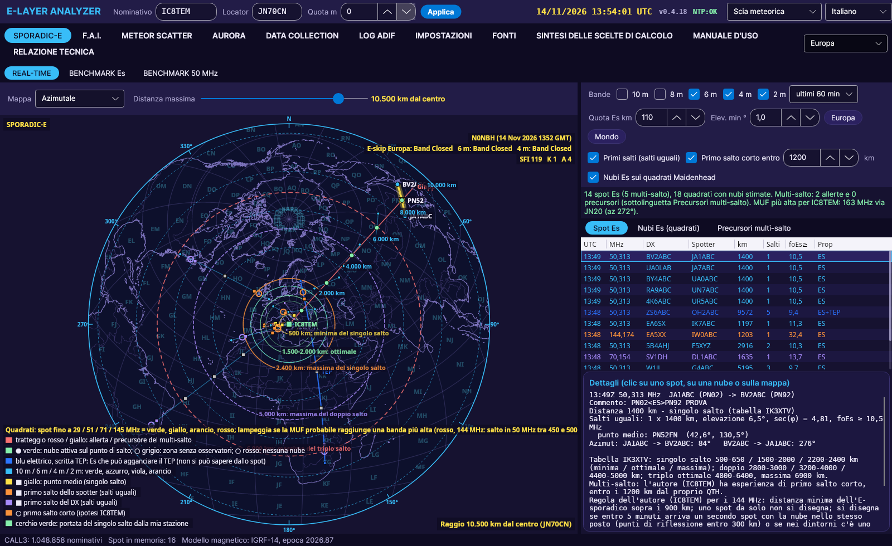
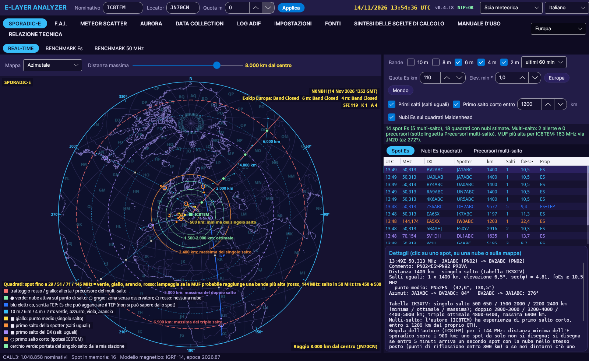

# SPORADIC-E

[← Domů](Home-cs)

## Mapa

Tlačítko nad mapou volí zobrazení:

- **Azimutální**: azimutální ekvidistantní mapa se středem ve vaší stanici, s posuvníkem **zvětšení** (300 až 20000 km od středu, také kolečkem myši).
- **Mercator**: mapa světa s tlačítky Evropa a Svět.

V obou projekcích se kolem stanice kreslí **kruhy vzdáleností podle Flavia IK3XTV**: 500 km (minimum jednoho skoku), 1500-2000 km (optimum), 2400 km (maximum jednoho skoku), 5000 km (maximum dvojitého skoku) a 6900 km (maximum trojitého skoku).

V azimutálních zobrazeních ukazují čárkované kruhy **km od středu** (krok se mění se zvětšením), okraj označuje maximální zobrazenou vzdálenost a kurzor myši ukazuje vzdálenost a azimut od středu.

## Co zobrazuje

- **Spoty** posledních minut (15 min - 12 h) na pásmech **28, 50, 70 a 144 MHz**, převzaté z relací telnet. Lokátory pocházejí z komentáře spotu (např. `JN70CN<ES>JO62QM`) nebo z databáze CALL3.
- Spoty s **<MS>**, **<AU>** nebo **<TR>** v textu se **zahazují**: netýkají se sporadické vrstvy E, ale jsou užitečné pro meteor scatter, auroru nebo tropo.
- **Transekvatoriální, pravidlo autora (IC8TEM)**: směrem do Afriky a Jižní Ameriky, pokud střed trasy padne do pásu magnetické inklinace mezi -20° a +20°, je spojení transekvatoriální (TEP) a ne přes sporadickou vrstvu E, pokud spot neuvádí `<ES>`.
- **144 MHz, pravidlo autora (IC8TEM)**: sporadická vrstva E na 2 m začíná **nad 900 km** (kratší spoty se zahazují). Jediný spot na 144 MHz **se samostatně nekreslí**: objeví se, když do **5 minut** přijde druhý spot na 144 MHz s oblakem na stejném místě (body odrazu do 300 km), nebo když je poblíž spot **50 MHz s krátkým skokem** (do 1200 km, za posledních 15 minut). Lišta nahoře ukazuje, kolik spotů na 144 MHz čeká na potvrzení.
- Pro každý spot: vzdálenost, **počet skoků** podle tabulky **IK3XTV**, elevace, **minimální foEs** (zákon sekanty).
- **První skok obou stanic**: oranžový čtverec = první skok spottera, fialový = první skok DX (stejné skoky); žlutý = střed trasy jednoho skoku.
- **Krátký první skok** (prázdné kruhy): při otevřeních s vícenásobným skokem má autor zkušenost s krátkým prvním skokem do **1200 km** od vlastního QTH; délku lze nastavit.
- **Oblaka Es** na **čtvercích Maidenhead** (2° x 1°), obarvená podle minimální foEs: modrá < 5, světle modrá < 7, zelená < 10, žlutá < 14, oranžová < 20, červená > 20 MHz.
- Tabulka **Oblaka Es**: pro každý čtverec **MUF pro vaši stanici** (červená = 144 MHz možné, oranžová = 70, žlutá = 50).

## Tabulka IK3XTV

| | minimum | optimum | maximum |
|---|---|---|---|
| Jeden skok | 500-650 km | 1500-2000 km | 2200-2400 km |
| Dvojitý skok | 2800-3000 km | 3200-4000 km | 4400-5000 km |
| Trojitý skok | – | 4800-6400 km | 6900 km |

## Jak ji používat

- **Kliknutí na spot**: trasa se zvýrazní, s body odrazu, lokátory a azimuty v podrobnostech.
- **Kliknutí na spot** v tabulce: trasa se na mapě rozsvítí (žlutý svit), a pokud je mimo zorné pole, mapa se posune nebo zvětší poloměr, aby ji ukázala. Spot zůstane vybrán, i když přicházejí nové spoty.
- **Tabulka sleduje mapu**: při nastaveném zvětšení ukazují tabulka spotů a tabulka oblaků jen to, co je vidět na mapě.
- **Kliknutí na mapu**: bod se posuzuje jako možný oblak Es, s foEs potřebnou pro 28, 50, 70 a 144 MHz.

## Poznámka k 432 MHz

Sporadická vrstva E **se netýká 432 MHz**: MUF Es dosahuje asi 150-200 MHz a rekordy ARRL uvádějí spojení přes Es jen na 50 a 144 MHz. Spoty v pásmu 70 cm se zde neanalyzují.

## Čtverce obarvené podle kmitočtu a blikání MUF

Čtverce Maidenhead bodů odrazu jsou obarveny podle nejvyššího kmitočtu spotů: **zelená** do 29 MHz, **žlutá** do 51, **oranžová** do 71, **červená** do 145 MHz. Z foEs čtverce se odhaduje pravděpodobná MUF na nejdelším skoku (2400 km, tabulka IK3XTV): pokud dosáhne vyššího pásma, čtverec **bliká** barvou tohoto pásma (princip IK3XTV a Jacobse-Leinwolla: krátký skip znamená vysokou MUF).

Vpravo nahoře na mapě se zobrazuje souhrn N0NBH (E-skip pro zvolený kontinent, SFI, indexy K a A).
