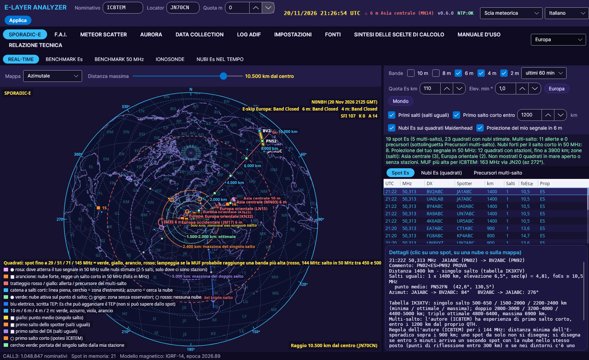

# SPORADIC-E

[← Home](Home-tr)

## Harita

Haritanın üstündeki bir düğme görünümü seçer:

- **Azimutal**: istasyonunuzu merkez alan azimutal eşuzaklık haritası, **yakınlaştırma** kaydırıcısıyla (merkezden 300 ile 20000 km arası, fare tekerleğiyle de).
- **Mercator**: Avrupa ve Dünya düğmeleriyle dünya haritası.

Her iki izdüşümde de istasyonun çevresine **Flavio IK3XTV'nin mesafe çemberleri** çizilir: 500 km (tek atlamada en az), 1500-2000 km (en uygun), 2400 km (tek atlamada en çok), 5000 km (çift atlamada en çok) ve 6900 km (üçlü atlamada en çok).

Azimutal görünümlerde kesikli halkalar **merkezden km** değerini gösterir (adım yakınlaştırmayla değişir), kenar gösterilen en büyük mesafeyi işaretler ve fare imleci merkezden mesafeyi ve azimutu verir.

## Ne gösterir

- Telnet oturumlarından alınan, **28, 40 (8 m, başlangıçta kapalı), 50, 70 ve 144 MHz** bantlarındaki son birkaç dakikanın (15 dk - 12 sa) **spot'ları**. Lokatörler spot yorumundan (örn. `JN70CN<ES>JO62QM`) ya da CALL3 veritabanından gelir.
- Metninde **<MS>**, **<AU>** ya da **<TR>** bulunan spot'lar **atılır**: sporadik E ile ilgili değildir, ama meteor scatter, aurora ya da tropo için yararlıdır.
- **Transekvatoryal, yazarın kuralı (IC8TEM)**: Afrika ve Güney Amerika yönünde, orta nokta -15° ile +15° arasındaki manyetik eğim kuşağına düşüyorsa (Cracknell, UKSMG'den alınan değer: TEP bölgeleri sıfır eğim çizgisinden yaklaşık 5-15° uzakta) bağlantı sporadik E değil transekvatoryaldir (TEP); spot `<ES>` belirtmiyorsa.
- **144 MHz, yazarın kuralı (IC8TEM)**: 2 m'de sporadik E **900 km'nin ötesinde** başlar (daha kısa spot'lar atılır). Tek bir 144 MHz spot'u **tek başına çizilmez**: **5 dakika** içinde bulutu aynı yerde olan (yansıma noktaları 300 km içinde) ikinci bir 144 MHz spot'u geldiğinde ya da yakınlarda (1200 km içinde, son 15 dakikada) **kısa atlamalı bir 50 MHz** spot'u olduğunda görünür. Üstteki çubuk, doğrulama bekleyen 144 MHz spot'larının sayısını gösterir.
- Her spot için: mesafe, **IK3XTV** tablosuna göre **atlama sayısı**, elevasyon, **en düşük foEs** (sekant yasası).
- **İki istasyonun ilk atlaması**: turuncu kare = spotter'ın ilk atlaması, mor = DX'in ilk atlaması (eşit atlamalar); sarı = tek atlamanın orta noktası.
- **Kısa ilk atlama** (içi boş daireler): çok atlamalı açılışlarda yazar, kendi QTH'sinin **1200 km** yakınında kısa bir ilk atlama deneyimlemiştir; uzunluk ayarlanabilir.
- **Maidenhead kareleri** (2° x 1°) üzerinde, en düşük foEs'e göre renklendirilmiş **Es bulutları**: mavi < 5, açık mavi < 7, yeşil < 10, sarı < 14, turuncu < 20, kırmızı > 20 MHz.
- **Es bulutları** tablosu: her kare için **istasyonunuzun MUF'u** (kırmızı = 144 MHz olası, turuncu = 70, sarı = 50).

## IK3XTV tablosu

| | en az | en uygun | en çok |
|---|---|---|---|
| Tek atlama | 500-650 km | 1500-2000 km | 2200-2400 km |
| Çift atlama | 2800-3000 km | 3200-4000 km | 4400-5000 km |
| Üçlü atlama | – | 4800-6400 km | 6900 km |

## Nasıl kullanılır

- **Bir spot'a tıklayın**: yol vurgulanır; ayrıntılarda yansıma noktaları, lokatörler ve azimutlar yer alır.
- Tabloda **bir spot'a tıklayın**: yol haritada parlar (sarı hale) ve görünüm dışındaysa harita onu göstermek için kayar ya da yarıçapını genişletir. Yeni spot'lar gelirken spot seçili kalır.
- **Tablo haritayı izler**: bir yakınlaştırma ayarlıyken spot tablosu ve bulut tablosu yalnızca haritada görüneni gösterir.
- **Haritaya tıklayın**: nokta olası bir Es bulutu olarak ele alınır; 28, 50, 70 ve 144 MHz için gereken foEs ile.

## 432 MHz hakkında not

Sporadik E **432 MHz için geçerli değildir**: Es MUF'u yaklaşık 150-200 MHz'e ulaşır ve ARRL rekorları Es bağlantılarını yalnızca 50 ve 144 MHz'de listeler. 70 cm spot'ları burada çözümlenmez.

## Frekansa göre renklendirilen kareler ve yanıp sönen MUF

Yansıma noktalarının Maidenhead kareleri spot'ların en yüksek frekansına göre renklendirilir: 29 MHz'e kadar **yeşil**, 51'e kadar **sarı**, 71'e kadar **turuncu**, 145 MHz'e kadar **kırmızı**. Karenin foEs'inden en uzun atlamadaki (2400 km, IK3XTV tablosu) olası MUF tahmin edilir: daha yüksek bir banda ulaşırsa kare o bandın renginde **yanıp söner** (IK3XTV ve Jacobs-Leinwoll ilkesi: kısa skip yüksek MUF demektir). 144 MHz için yazarın kuralı geçerlidir: kare yalnızca bulut 450 ile 500 km arasında tek bir 50 MHz atlaması veriyorsa (50 km toleransla 450 km) kırmızı yanıp söner.

Haritanın sağ üstünde N0NBH özeti görünür (seçilen kıta için E-skip, SFI, K ve A indeksleri).

## Banda göre kurallar (sürüm 0.4.18)

- **50 MHz**: 450 km içinde Sporadic-E yoktur. FT8 ve FT4 spot'ları yalnızca bir buluta aitse Sporadic-E'dir: 4 dakika içinde orta noktası 150 km içinde olan başka bir 50 MHz spot'u. Tek başına bir FT8/FT4 spot'u meteor scatter'a gider.
- **70 MHz**: 450 km içinde Sporadic-E yoktur. FT8 ve FT4, bant planının meteor scatter penceresi içinde bile Sporadic-E'ye gider (önce bilinen mod, sonra frekans belirler).
- **40 MHz (8 m)**: en kısa mesafe, 50 MHz'in 450 km'sinden sekant yasasıyla türetilir (yaklaşık 330 km); yalnızca E katmanı geometrisinin ilk atlaması içindeki mesafeler (yaklaşık 2440 km). Yol rengi: sarı.
- **144 MHz**: doğrulamayla 900 km'den itibaren Sporadic-E; Q65 ve JT65 spot'ları EME'dir ve metinde `<ES>` yoksa atılır.
- G0ISW (Propagation identification, 2024) en kısa Sporadic-E'yi 50 ve 70 MHz'de 400 km'nin, 144 MHz'de 1400 km'nin ötesinde görür: yazarın kuralları 50 ve 70 MHz'de örtüşür, 144 MHz'de daha geniştir ama doğrulama ister.
- Tüm kuralların uygulanma sırası, kullanılan değerlerle birlikte, **[AYARLAR](Settings-tr)** › Spot yönlendirme bölümünde gösterilir.

## Kısa atlamalı zincirler (0.6.0 sürümünden itibaren)

**Çok atlama öncülleri** alt sekmesinde program, 50 MHz'deki çok atlama zincirlerini yazarın üç koşuluyla arar: MUF'u 50 MHz civarında olan, 11-21 MHz foEs gerektiren **ilk ve son kısa atlama** (500-1200 km) ve yaklaşık 9,3 MHz gerektiren, 2200 km'ye kadar **orta atlamalar**.

- **Güçlü bulutlar** (turuncu kareler): tüm dünyanın Es spot'ları ve foEs'i en az 11,3 MHz olan GIRO iyonosondları.
- **QTH'den**: istasyonunuzdan ilk kısa atlama ve aynı yön boyunca başka bir güçlü buluta son kısa atlama, aynı kıtada da (örneğin Kazakistan'da); daire varış bölgesidir.
- **Koridor**: herhangi iki güçlü bulut, her yönde, örneğin **Karayipler - İber Yarımadası** veya **Avrupa - Batı Afrika** (TEP hariç); bir uç size 1200 km içindeyse «sizi ilgilendiriyor».
- **Bulutu ara**: yalnızca ilk kısa atlama var; açık mavi bölgeler son kısa atlamanın bulutunun nerede olması gerektiğini söyler.
- Orta atlamalar bulutlarla kapsanmışsa **UYARI**, yalnızca gözlemcisiz bölgeler eksikse **ÖNCÜL**.
- AYARLAR'da sizi ilgilendiren UYARILAR için üstte **bildirim** (isteğe bağlı olarak bir pencere de) vardır.
- **Açık denize** ya da istasyon olmayan yerlere (CALL3 ve spot'lar) ulaşan zincirler gösterilmez.
- **Eşit çift atlama** (0.6.3 sürümünden itibaren, «2 =» atlamalar): yaklaşık 4700 km'ye kadar, örneğin Kazakistan'a doğru, ITU-R P.534-6 yöntemindeki gibi bulut yolun dörtte birinde.
- **ATLAMA TABLOSU** sekmesi, 50 MHz'de 500 ile 12000 km arasında kaç atlama gerektiğini, her atlamanın foEs değeri ve kaynaklarla özetler.
- **6 m'de sinyalimin ayak izi** (pembe noktalar): 50 MHz'deki sinyalinizin 2-5 atlamadan sonra, tüm bantların (28-144 MHz) spot'larından ve iyonosondlardan tahmin edilen son 30 dakikanın bulutları üzerinden düştüğü yer; yalnızca istasyon olan yerlerde.

